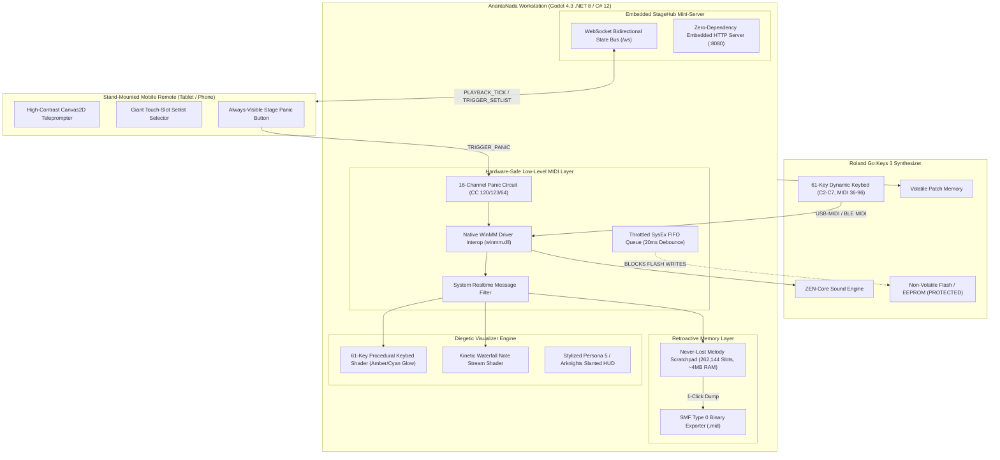

# ANANTANADA: Hybrid Workstation & Stage Console
### Dedicated Performance Engine & Stylized Diegetic Stage Console for Roland Go:Keys 3 (61-Key Synthesizer/Arranger)

[](https://godotengine.org)
[](https://www.roland.com/global/products/gokeys_3/)
[-00f5d4)](#-hardware-safety-principles)
[](#-embedded-stagehub-telemetry-server)
[](USER_GUIDE.md)

> **Design Paradigm:** Game-Grade Diegetic Stage Console (*Persona 5* / *Arknights* / *Hi-Fi Rush*)  
> **Host Runtime:** Godot Engine 4.3 (.NET 8 / C# 12)  
> **Companion Client:** Embedded Local HTTP & WebSocket Server + HTML5 / Canvas2D Remote  
> **Remote Repository:** [https://github.com/y7thangeru/AnantaNada](https://github.com/y7thangeru/AnantaNada)  
> **Buku Panduan Operasional Lengkap:** [USER_GUIDE.md](USER_GUIDE.md)

---

## 🎨 Visual Stage Showcase

| Godot 4 Native Stage Console (1080p Forward+) | Stand-Mounted Mobile Teleprompter & Setlist Remote |
| :---: | :---: |
|  |  |

---

## 🌟 Architecture & Core Guarantees



---

## 🛡️ Hardware Safety Principles (Roland Go:Keys 3)

1. **Zero Non-Volatile Flash Writes (`SelectPatchVolatile`)**:
   - Tone navigation executed exclusively via volatile standard MIDI messaging:
     - Bank Select MSB (`CC 00`)
     - Bank Select LSB (`CC 32`)
     - Program Change (`PC 0-127`)
   - Internal keyboard EEPROM / system flash memory is strictly untouched, guaranteeing zero flash endurance wear during intensive live performances.

2. **Throttled SysEx FIFO Queue (`MidiConstants.SysExDebounceMs = 20ms`)**:
   - Outbound SysEx dumps are paced by a dedicated background worker thread with a strict 20ms debounce limiter, preventing processor buffer overflows on the Roland instrument.

3. **Global Panic Failsafe Circuit**:
   - Immediate emergency broadcast of `CC 120` (All Sound Off), `CC 123` (All Notes Off), and `CC 64` (Sustain Off = 0) across all 16 MIDI channels.
   - Clears hanging or stuck notes within 1 millisecond if USB cables are accidentally disconnected or Bluetooth LE MIDI suffers packet dropouts.

4. **Zero-Allocation Hot Path**:
   - Direct P/Invoke integration with `winmm.dll` using pinned delegate callbacks and value-type `MidiRawMessage` structs. Zero heap allocations during live performance.

---

## 🧠 "Never-Lost Melody" Retroactive Scratchpad

- Continuously buffers all incoming MIDI events in a lock-free circular ring buffer (262,144 event slots, consuming ~4 MB of RAM).
- Stores up to 5 minutes of continuous playing history with microsecond-accurate hardware timestamps.
- **1-Click Export**: Tapping *"⚡ AMBIL IDE TADI"* immediately serializes the buffer into a valid Standard MIDI File (`.mid`, SMF Type 0) with automatic resolution of hanging notes and variable-length quantity (VLQ) delta times.

---

## 📱 Embedded StageHub & Teleprompter

- Built-in zero-dependency HTTP and WebSocket server running inside the Godot .NET host on port `8080`.
- Connect any stand-mounted smartphone or tablet over local Wi-Fi or mobile hotspot.
- Displays auto-scrolling chord charts, metronome pulses, current/next chord lookahead, giant touch setlist slots, and an emergency panic button.

---

## 📖 Cara Menggunakan Project & Aplikasi (Quick Operational Guide)

> Untuk panduan langkah-demi-langkah mendalam dan SOP panggung, buka [USER_GUIDE.md](USER_GUIDE.md).

### 1. Persiapan Koneksi Hardware
1. Hubungkan port **USB Computer** di bagian belakang Roland Go:Keys 3 ke port USB laptop Anda menggunakan kabel USB Type-B ke USB-A / USB-C.
2. Nyalakan Roland Go:Keys 3. Driver Windows (`winmm.dll`) akan mendeteksinya secara otomatis.
3. Di menu keyboard: pastikan `MIDI Rx/Tx Channel` aktif di Channel 1, dan `Program Change Tx/Rx` di-set **ON**.

### 2. Menjalankan Workstation di Komputer
- **Mode A: Verifikasi C# Subsystem (CLI)**:
  ```powershell
  dotnet run
  ```
  Menjalankan tes otomatis untuk buffer RAM, eksportir SMF Type 0, dan sirkuit Panic.
- **Mode B: Menjalankan Konsol Panggung (Godot Engine)**:
  1. Buka **Godot Engine 4.3+ (.NET edition)**.
  2. Klik **Import** -> Pilih `project.godot`.
  3. Tekan **F5** (atau klik Run). Layar HUD panggung 1080p akan langsung menyala!

### 3. Menggunakan Konsol Utama (Desktop Stage Console)
- **Status Koneksi**: Indikator *Device Pill* di bar atas akan otomatis menampilkan nama perangkat Roland yang tersambung.
- **Visual Keybed 61-Tuts**: Tuts yang ditekan akan memancarkan cahaya neon GPU secara instan:
  - Tangan Kiri (Bass / Akord, tuts 1–24): **Electric Amber** (`#ffb703`).
  - Tangan Kanan (Melodi / Lead, tuts 25–61): **Cyber Cyan** (`#00f5d4`).
- **Ekspor Melodi Instan**: Klik tombol **"⚡ AMBIL IDE TADI (5-MIN RETROACTIVE)"** di bar bawah kapan saja untuk menyimpan 5 menit permainan terakhir Anda ke file MIDI `captures/jam_YYYYMMDD_HHmmss.mid`.
- **Tombol Darurat (Panic)**: Klik tombol merah **PANIC** jika terjadi nada macet karena kabel tersenggol.

### 4. Menghubungkan HP / Tablet ke StageHub Mobile Remote
1. Sambungkan HP atau tablet ke jaringan Wi-Fi yang sama dengan laptop (atau nyalakan **Mobile Hotspot** di laptop Anda).
2. Buka browser (Chrome / Safari) di HP/tablet, lalu ketik alamat yang tertera di layar panggung, misalnya:
   ```text
   http://192.168.1.15:8080
   ```
3. Layar teleprompter hitam OLED akan terbuka seketika:
   - **Akord Raksasa**: Menampilkan akord saat ini (72pt) dan akord antisipasi berikutnya (32pt) dari jarak 2 meter.
   - **Setlist Sentuh**: Tap nama lagu di HP untuk langsung mengganti sound Roland Go:Keys 3 dan tempo metronom di laptop.
   - **Panic HP**: Tombol merah di bagian bawah HP untuk membisukan instrumen dari stand mikrofon.

---

## 📁 Multi-Tiered Directory Architecture

```text
AnantaNada_RolandGoKeys3/
├── addons/
│   └── godot_mcp/                      # Godlink WebSocket Editor Bridge (Port 6505)
├── scenes/
│   ├── MainStageView.tscn              # Godot 4 main stage scene & stylized node hierarchy
│   └── README.md                       # Documentation for scene hierarchy and HUD layout
├── scripts/
│   ├── capture_stage_screenshot.gd     # Headless 1080p stage HUD capture tool
│   └── capture_web_remote.py           # Web remote companion client capture utility
├── src/
│   ├── Core/
│   │   └── Midi/
│   │       ├── MidiConstants.cs        # Roland Go:Keys 3 CC numbers, status bytes & safety timings
│   │       ├── NativeMidiEngine.cs     # Zero-allocation WinMM interop, SysEx FIFO & Panic circuit
│   │       ├── RetroactiveBuffer.cs    # Lock-free 5-min RAM ring buffer & SMF Type 0 exporter
│   │       └── README.md               # Documentation for Core MIDI math & native drivers
│   ├── Network/
│   │   ├── StageHubServer.cs           # Embedded HTTP & WebSocket server for stage remote
│   │   ├── TelemetryContracts.cs       # Strong-typed JSON contracts (PLAYBACK_TICK, etc.)
│   │   └── README.md                   # Documentation for network topology & data contracts
│   ├── Shaders/
│   │   ├── piano_keybed.gdshader       # 61-Key procedural keybed shader with velocity glow
│   │   ├── waterfall_visualizer.gdshader # High-energy kinetic falling notes shader
│   │   └── README.md                   # Documentation for GPU shader mathematics & uniforms
│   ├── UI/
│   │   ├── MainStageController.cs      # Main Godot UI controller node connecting engine to scene
│   │   └── README.md                   # Documentation for controller lifecycle & state textures
│   ├── Tests/
│   │   └── VerificationHarness.cs      # Self-auditing unit verification suite
│   └── Program.cs                      # Host bootstrap entry point
├── web/
│   ├── index.html                      # Mobile teleprompter & setlist HUD
│   ├── style.css                       # Stylized high-contrast dark theme
│   ├── app.js                          # WebSocket client & teleprompter canvas renderer
│   └── README.md                       # Documentation for mobile remote client
├── captures/                           # Output directory for retroactive .mid exports and screenshots
│   ├── screenshot_godot_stage.png      # 1080p visual capture of native stage console
│   └── screenshot_web_remote.png       # Visual capture of mobile stage teleprompter HUD
├── project.godot                       # Godot 4.3 project configuration
├── AnantaNada.csproj                   # .NET 8 / C# 12 project file with GodotSharp integration
├── ANANTANADA_SPEC.md                  # Comprehensive architectural specification
├── USER_GUIDE.md                       # Buku panduan penggunaan lengkap & SOP panggung
├── Feature-ToBe-Implemented.md         # Single source of truth for feature tracking
├── update_tracker.md                   # Audit log of all file changes and rationale
└── Report-To-GeminiProject.md          # Consolidated master report for Gemini project threads
```

---

## 🚀 Quickstart & Verification Commands

```powershell
# 1. Kompilasi & Uji Mandiri Engine C#
dotnet run

# 2. Tangkap Screenshot Headless Konsol Panggung
godot --headless -s scripts/capture_stage_screenshot.gd

# 3. Jalankan Remote Companion di Browser
python scripts/capture_web_remote.py
```
