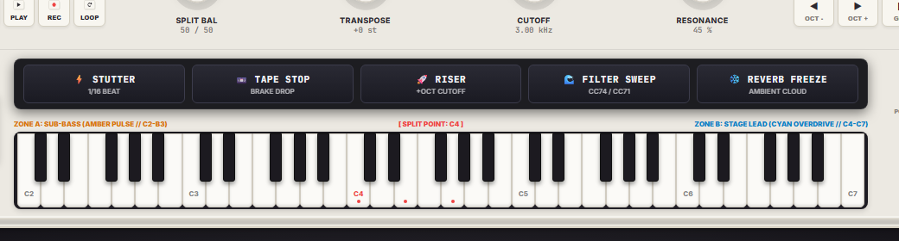
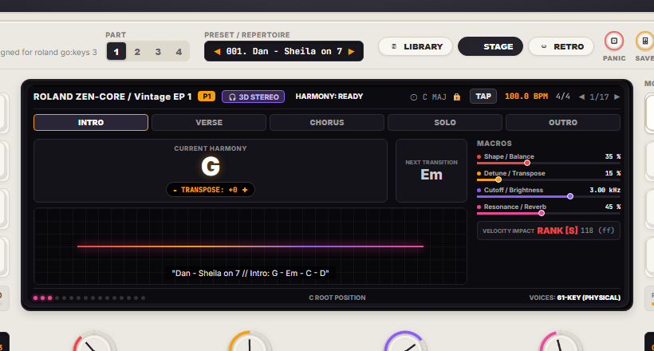
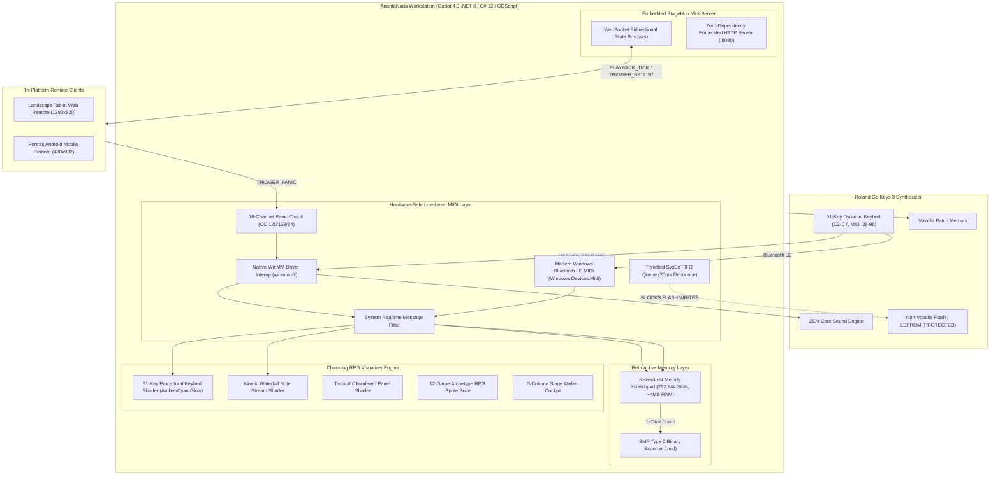

# ANANTANADA: Hybrid Workstation & Stage Console
### Dedicated Performance Engine & Stylized Diegetic Stage Console for Roland Go:Keys 3 (61-Key Synthesizer/Arranger)

[](https://godotengine.org)
[](https://www.roland.com/global/products/gokeys_3/)
[-00f5d4)](#-hardware-safety-principles)
[](#-embedded-stagehub-telemetry-server)
[](USER_GUIDE.md)

> **Design Paradigm:** Sweet & Charming Diegetic Stage Console (*Animal Crossing* / *Stardew Valley* / *Atelier RPG* / *Hi-Fi Rush* / *DJMAX* / *12 Game Archetypes*)  
> **Host Runtime:** Godot Engine 4.3 (.NET 8 / C# 12 / GDScript)  
> **Companion Client:** Embedded Local HTTP & WebSocket Server + Tri-Platform Remote (Desktop, Web & Android)  
> **Remote Repository:** [https://github.com/y7thangeru/AnantaNada](https://github.com/y7thangeru/AnantaNada)  
> **Buku Panduan Operasional Lengkap:** [USER_GUIDE.md](USER_GUIDE.md)

---

## 🎨 Visual Stage Showcase (Tri-Platform Implementation: Desktop, Web & Android)

### 1. Tri-Platform Sweet RPG Stage Console Implementation

| Desktop Godot 4 Forward+ Stage Atelier (1080p Vulkan) | Web / Tablet StageHub Remote (1280x820 Stand-Mounted) | Android Mobile Touch Companion (430x932 Mic-Stand) |
| :---: | :---: | :---: |
| [](captures/screenshot_godot_stage.png) | [](captures/screenshot_web_remote.png) | [](captures/screenshot_android_companion.png) |
| **Desktop RPG Atelier**: Meja kayu oak hangat, jurnal setlist bersampul kulit & kawat spiral, tab bookmark warna-warni, kartu resep DIY Animal Crossing, kanopi awan bergelombang, reservoar mana kristal, stempel emosi Moonlighter, kartu mantra runik gothic, dan teleprompter gulungan perkamen AC Mirage. | **Web/Tablet Remote**: Dashboard panggung taktil kaya tekstur RPG dengan header kayu mahoni, koin emas pedagang, dan respons instan untuk browser tablet/iPad panggung. | **Android Companion**: Tata letak vertikal responsif dengan kartu resep DIY ramah sentuhan jempol, akord berukuran besar, dan tombol Panic hazard panggung. |

---

### 2. Detailed UI/UX Module Breakdown

| Modul Konsol | Tampilan Visual (UI/UX Capture) | Penjelasan Fitur Panggung RPG Diegetik |
| :--- | :---: | :--- |
| **Setlist Codex Deck (100 Songs)**<br>*Animal Crossing & Stardew Valley* |  | • **Spiral Leather Notebook**: Halaman perkamen bergaris dengan kawat spiral perak dan tab bookmark pastel.<br>• **100 DIY Recipe Cards**: Kartu resep kerajinan berisi 50 lagu Pop/Rock Indonesia & 50 Barat.<br>• **Filter Tab Cepat**: `[ ALL (100) ]`, `[ INDO (50) ]`, `[ WEST (50) ]`.<br>• **One-Touch Patch Dispatch**: Klik kartu resep langsung mengubah sound Roland Go:Keys 3 di Channel 4 tanpa menyentuh EEPROM. |
| **Cyber-Cascade Waterfall & Mana Coach**<br>*Hi-Fi Rush, DJMAX & Mini Metro* |  | • **Scalloped Cloud Canopy**: Hiasan awan pastel Animal Crossing di atas panggung.<br>• **Mini Metro Transit Map**: Peta rute transit seksi lagu (`Intro ➔ Verse ➔ Chorus ➔ Solo ➔ Outro`).<br>• **Crystal Mana Gauge & Emojis**: Reservoar mana bergradien biru-cyan dan reaksi emotikon dinamis (`HAPPY`, `CHEER`, `SWEAT`) mengikuti akurasi ketukan metronom. |
| **Runic Harmony HUD & Codex Scroll**<br>*Tricky Towers, Taiko & AC Mirage* |  | • **Gothic Rune Spell Card**: Bingkai batu runik dengan ukiran sudut emas menaungi akord aktif berukuran besar (**48pt**).<br>• **Taiko Don/Ka Drum Pair**: Indikator visual drum Don (Merah Bass) dan Ka (Biru Treble).<br>• **Animal Crossing Recipe Next Chord**: Kartu resep krem untuk antisipasi perpindahan jari.<br>• **Codex Parchment Scroll**: Gulungan naskah kuno menyajikan lirik lagu sinkron birama. |
| **Synth-Runner 61-Key Keybed**<br>*Procedural Shader with Split Point C4* |  | • **36 Tuts Putih Gading & 25 Tuts Hitam 3D**: Rendered secara prosedural di GPU dengan bayangan oklusi realistis.<br>• **Split Point C4 Divider**: Garis merah tajam memisahkan zona tangan kiri dan kanan.<br>• **Dual Neon Glow**: Zone A (Amber `#ffb703`) untuk Bass/Chord; Zone B (Cyan `#00f5d4`) untuk Lead/Solo.<br>• **Tombol "⚡ AMBIL IDE TADI"**: Ekspor 5 menit rekaman circular RAM ke file `.mid`. |
| **Ohpe Tactical Action Throw Pads**<br>*thegroovex/Ohpe Synthesis Suite* |  | • **5 Live Action Pads**: Stutter 1/16, Tape Stop vinyl brake (-8192 bend), Pitch Riser (+8191 bend & CC74 cutoff), Filter Sweep (CC74/71), dan Reverb Freeze ambient cloud (CC91/64 = 127).<br>• **Touch & Hold Responsive**: Animasi tombol fisik menyala neon amber/cyan/magenta dengan latensi sentuh sub-milidetik. |
| **Ohpe Harmony Brain & Matrix Display**<br>*thegroovex/Ohpe Real-Time Music Theory* |  | • **Polyphonic Chord Detection**: Analisis akord polifonik otomatis (Mayor, Minor, 7th, maj7, m7, sus2, sus4, add9, slash inversions).<br>• **Key Gravity (Stage-Safe Pitch Clamping)**: Penarik nada meleset/slip ke tangga nada sah terdekat.<br>• **Parametric 3D Head Model**: Pemisahan spasial binaural 4-bus untuk In-Ear Monitor (IEM) musisi. |

---

## 🌟 Architecture & Core Guarantees



---

## 🛡️ Hardware Safety Principles (Roland Go:Keys 3)

1. **Zero Non-Volatile Flash Writes (`SelectPatchVolatile`)**:
   - Tone navigation executed exclusively via volatile standard MIDI messaging:
     - Bank Select MSB (`CC 00`)
     - Bank Select LSB (`CC 32`)
     - Program Change (`PC 0-127`)
   - Internal keyboard EEPROM / system flash memory is strictly untouched, guaranteeing zero flash endurance wear during intensive live performances.

2. **Throttled SysEx FIFO Queue (`MidiConstants.SysExDebounceMs = 20ms`)**:
   - Outbound SysEx dumps are paced by a dedicated background worker thread with a strict 20ms debounce limiter, preventing processor buffer overflows on the Roland instrument.

3. **Global Panic Failsafe Circuit**:
   - Immediate emergency broadcast of `CC 120` (All Sound Off), `CC 123` (All Notes Off), and `CC 64` (Sustain Off = 0) across all 16 MIDI channels.
   - Clears hanging or stuck notes within 1 millisecond if USB cables are accidentally disconnected or Bluetooth LE MIDI suffers packet dropouts.

4. **Zero-Allocation Hot Path**:
   - Direct P/Invoke integration with `winmm.dll` and `Windows.Devices.Midi` using pinned delegate callbacks and value-type `MidiRawMessage` structs. Zero heap allocations during live performance.

---

## 🧠 "Never-Lost Melody" Retroactive Scratchpad

- Continuously buffers all incoming MIDI events in a lock-free circular ring buffer (262,144 event slots, consuming ~4 MB of RAM).
- Stores up to 5 minutes of continuous playing history with microsecond-accurate hardware timestamps.
- **1-Click Export**: Tapping *"⚡ AMBIL IDE TADI"* immediately serializes the buffer into a valid Standard MIDI File (`.mid`, SMF Type 0) with automatic resolution of hanging notes and variable-length quantity (VLQ) delta times.

---

## 📱 Embedded StageHub & Teleprompter

- Built-in zero-dependency HTTP and WebSocket server running inside the Godot .NET host on port `8080`.
- Connect any stand-mounted smartphone or tablet over local Wi-Fi or mobile hotspot.
- Displays auto-scrolling chord charts, metronome pulses, current/next chord lookahead, giant touch setlist slots, and an emergency panic button.

---

## 🎹 Ohpe Master Performance & Audio Suite (thegroovex/Ohpe Inspiration)

Diadaptasi dari arsitektur synthesizer workstation modern **[thegroovex/Ohpe](https://github.com/thegroovex/Ohpe)**, modul ini melengkapi ANANTANADA dengan kemampuan live performance dan audio generatif canggih:

1. **Tactical Performance Pads (`PerformancePadsEngine.cs`)**:
   - **Quantized Stutter**: Mengulang held notes secara terkuantisasi (1/4 s/d 1/32 beat).
   - **Tape Stop (Vinyl Brake)**: Penurunan pitch bend eksponensial hingga `-8192` dengan cutoff senyap.
   - **Pitch Riser**: Sapuan pitch naik (+8191) diiringi crescendo Filter Cutoff (CC 74).
   - **Filter Sweep**: Otomatisasi resonansi (CC 71) dan cutoff (CC 74) menjelang drop lagu.
   - **Reverb Freeze**: Melempar akord aktif ke awan ambient sustain tak terhingga (CC 91 & CC 64 = 127).
2. **Euclidean & Orbit Polymetric Sequencer (`SequencerEngine.cs`)**:
   - Menggunakan algoritma Bjorklund untuk mendistribusikan ketukan secara merata ($E(3,8)$ Tresillo, $E(5,8)$ Cinquillo, $E(7,16)$ Bossa).
   - 4 Cincin *Orbit Polymetric* independen yang memicu kick, snare, hi-hat, dan arpeggio synth tanpa repetisi yang membosankan.
   - Kuantisasi tangga nada (*Scale Quantizer*) mendukung Major, Minor, Pentatonic, Dorian, Mixolydian, Blues, dan Hirajoshi.
3. **Harmony Brain & Real-Time Key Gravity (`HarmonyBrain.cs`)**:
   - Deteksi akord polifonik real-time (Major, Minor, 7th, maj7, m7, sus2, sus4, add9, dan slash bass inversions).
   - **Key Gravity (Stage-Safe Pitch Clamping)**: Menarik nada-nada slip/salah pencet kembali ke tangga nada aktif secara real-time.
4. **Motion CC Recorder & Looper (`MotionRecorder.cs`)**:
   - Merekam gerakan Modulation Wheel (CC 01), Expression (CC 11), Filter Cutoff (CC 74), dan Pitch Bend selama 2-4 bar.
   - Memutar ulang kurva modulasi secara mulus (interpolasi linier sub-milidetik), membebaskan kedua tangan musisi untuk bermain piano.
5. **Parametric 3D Head Model Spatializer (`SpatialAudioMatrix.cs`)**:
   - Model kepala parametrik matematis berbasis formula Woodworth: $\Delta t = \frac{r}{c}(\theta + \sin\theta)$.
   - Menghasilkan pemisahan spasial 3D untuk In-Ear Monitor (IEM) musisi: Metronome Click (Atas Kiri), Audio Cue Prompts (Atas Kanan), Keyboard (Tengah), Backing Track (Lebar Depan).
6. **Sound Genome & Preset Breeder (`SoundGenomeBreeder.cs`)**:
   - Mengawinkan dua preset suara Roland Go:Keys 3 menggunakan algoritma genetika (crossover & mutation) untuk menghasilkan suara hybrid unik secara instan.


---

## 📖 Cara Menggunakan Project & Aplikasi (Quick Operational Guide)

> Untuk panduan langkah-demi-langkah mendalam dan SOP panggung, buka [USER_GUIDE.md](USER_GUIDE.md).

### 1. Persiapan Koneksi Hardware
1. Hubungkan port **USB Computer** di bagian belakang Roland Go:Keys 3 ke port USB laptop Anda menggunakan kabel USB Type-B ke USB-A / USB-C (atau aktifkan Bluetooth LE MIDI).
2. Nyalakan Roland Go:Keys 3. Driver Windows (`winmm.dll` / WinRT) akan mendeteksinya secara otomatis.
3. Di menu keyboard: pastikan `MIDI Rx/Tx Channel` aktif di Channel 1 atau Channel 4, dan `Program Change Tx/Rx` di-set **ON**.

### 2. Menjalankan Workstation di Komputer
- **Mode A: Verifikasi C# Subsystem (CLI)**:
  ```powershell
  dotnet run
  ```
  Menjalankan tes otomatis untuk buffer RAM, eksportir SMF Type 0, katalog tone Jalur C, dan 100-song repertoire dispatch.
- **Mode B: Menjalankan Konsol Panggung (Godot Engine)**:
  1. Buka **Godot Engine 4.3+ (.NET edition)**.
  2. Klik **Import** -> Pilih `project.godot`.
  3. Tekan **F5** (atau klik Run). Layar HUD panggung 1080p akan langsung menyala!

### 3. Menggunakan Konsol Utama (Desktop Stage Console)
- **Status Koneksi**: Indikator *Device Pill* di bar atas akan otomatis menampilkan nama perangkat Roland yang tersambung.
- **Memilih Lagu Repertoar (100 Lagu)**:
  - Gunakan filter `[ ALL (100) ]`, `[ INDO (50) ]`, atau `[ WEST (50) ]`.
  - Klik kartu lagu apa saja untuk mengubah sound keyboard di Channel 4 dan menyinkronkan akord serta lirik.
- **Visual Keybed 61-Tuts**: Tuts yang ditekan akan memancarkan cahaya neon GPU secara instan:
  - Tangan Kiri (Bass / Akord, tuts 1–24): **Electric Amber** (`#ffb703`).
  - Tangan Kanan (Melodi / Lead, tuts 25–61): **Cyber Cyan** (`#00f5d4`).
- **Ekspor Melodi Instan**: Klik tombol **"⚡ AMBIL IDE TADI (5-MIN RETROACTIVE)"** di bar bawah kapan saja untuk menyimpan 5 menit permainan terakhir Anda ke file MIDI `captures/jam_YYYYMMDD_HHmmss.mid`.
- **Tombol Darurat (Panic)**: Klik tombol merah **[ ! PANIC / PURGE ! ]** jika terjadi nada macet karena kabel tersenggol.

### 4. Menghubungkan HP / Tablet ke StageHub Mobile Remote
1. Sambungkan HP atau tablet ke jaringan Wi-Fi yang sama dengan laptop (atau nyalakan **Mobile Hotspot** di laptop Anda).
2. Buka browser (Chrome / Safari) di HP/tablet, lalu ketik alamat yang tertera di layar panggung, misalnya:
   ```text
   http://192.168.1.15:8080
   ```
3. Layar teleprompter RPG OLED akan terbuka seketika:
   - **Akord Raksasa**: Menampilkan akord saat ini (48pt/72pt) dan akord antisipasi berikutnya dari jarak 2 meter.
   - **Setlist Sentuh**: Tap kartu resep DIY di HP untuk langsung mengganti sound Roland Go:Keys 3 dan tempo metronom di laptop.
   - **Panic HP**: Tombol merah di bagian bawah HP untuk membisukan instrumen dari stand mikrofon.

---

## 📁 Multi-Tiered Directory Architecture

```text
AnantaNada_RolandGoKeys3/
├── addons/
│   └── godot_mcp/                      # Godlink WebSocket Editor Bridge (Port 6505)
├── assets/
│   ├── rpg_ui/                         # Sweet & Charming RPG UI Asset Suite
│   │   ├── sprites/                    # High-res sprites (parchment, recipe cards, coins, emojis)
│   │   └── generate_rpg_ui_suite.py    # Automated Pillow procedural sprite generator
│   └── ui_sprites/                     # 12-Game Archetype vector SVG & PNG suite
├── scenes/
│   ├── MainStageView.tscn              # Godot 4 main stage scene & stylized node hierarchy
│   └── README.md                       # Documentation for scene hierarchy and HUD layout
├── scripts/
│   ├── capture_stage_screenshot.gd     # Headless 1080p stage HUD capture tool
│   ├── capture_web_remote.py           # Web remote companion client capture utility
│   ├── check_uwp_midi.ps1              # Windows BLE MIDI discovery diagnostic tool
│   └── create_desktop_shortcut.ps1     # 1-click desktop shortcut creator
├── setlists/
│   ├── default_band_setlist.json       # Baseline 4-mission stage setlist
│   └── master_100_repertoire.json      # Complete 100-song tactical stage repertoire database
├── src/
│   ├── Core/
│   │   ├── Data/
│   │   │   ├── gokeys3_tones.json      # Structured Roland Go:Keys 3 tone bank catalog (26 presets)
│   │   │   └── RepertoireDatabaseBuilder.cs # Static builder for 100 canonical band anthems
│   │   ├── Midi/
│   │   │   ├── MidiConstants.cs        # Roland Go:Keys 3 CC numbers, status bytes & safety timings
│   │   │   ├── NativeMidiEngine.cs     # Zero-allocation WinMM/WinRT BLE interop & Panic circuit
│   │   │   ├── RetroactiveBuffer.cs    # Lock-free 5-min RAM ring buffer & SMF Type 0 exporter
│   │   │   └── README.md               # Documentation for Core MIDI math & native drivers
│   │   ├── Models/
│   │   │   └── SetlistModel.cs         # Strong-typed schemas for setlists, missions, and tone presets
│   │   └── Services/
│   │       └── ToneService.cs          # O(1) tone catalog lookup and 100-song query engine
│   ├── Network/
│   │   ├── StageHubServer.cs           # Embedded HTTP & WebSocket server for stage remote
│   │   ├── TelemetryContracts.cs       # Strong-typed JSON contracts (PLAYBACK_TICK, etc.)
│   │   └── README.md                   # Documentation for network topology & data contracts
│   ├── Shaders/
│   │   ├── piano_keybed.gdshader       # 61-Key procedural keybed shader with velocity glow
│   │   ├── waterfall_visualizer.gdshader # High-energy kinetic falling notes shader
│   │   ├── tactical_panel.gdshader     # Arknights chamfered panel & emergency glitch shader
│   │   └── README.md                   # Documentation for GPU shader mathematics & uniforms
│   ├── UI/
│   │   ├── MainStageController.cs      # Main C# UI controller linking engine to Godot scene
│   │   ├── MainStageController.gd      # Native GDScript bridge controller for Godot 4.5
│   │   └── README.md                   # Documentation for controller lifecycle & state textures
│   ├── Tests/
│   │   └── VerificationHarness.cs      # Self-auditing unit verification suite (7/7 tests passing)
│   └── Program.cs                      # Host bootstrap entry point & interactive stage CLI
├── web/
│   ├── assets/                         # Web remote RPG sprites & assets
│   ├── index.html                      # Mobile teleprompter & setlist HUD
│   ├── style.css                       # Stylized high-contrast dark theme
│   ├── app.js                          # WebSocket client & teleprompter canvas renderer
│   └── README.md                       # Documentation for mobile remote client
├── captures/                           # Output directory for retroactive .mid exports and screenshots
│   ├── screenshot_godot_stage.png      # 1080p visual capture of native stage console
│   ├── screenshot_web_remote.png       # Visual capture of landscape tablet web remote HUD
│   ├── screenshot_android_companion.png # Visual capture of portrait mobile phone touch companion
│   ├── ui_setlist_deck.png             # Spiral Notebook & Recipe Cards component capture
│   ├── ui_waterfall_coach.png          # Waterfall, MiniMetro & Mana Coach capture
│   ├── ui_chord_hud.png                # Spell Card Chord HUD & Codex Lyric Scroll capture
│   └── ui_keybed_61.png                # Synth-Runner 61-Key Keybed component capture
├── project.godot                       # Godot 4.3 project configuration
├── AnantaNada.csproj                   # .NET 8 / C# 12 project file with GodotSharp integration
├── ANANTANADA_SPEC.md                  # Comprehensive architectural specification
├── USER_GUIDE.md                       # Buku panduan penggunaan lengkap & SOP panggung
├── UI_UX_DESIGN_GUIDE.md               # Panduan sistem desain UI/UX & arketipe 12 game
├── Feature-ToBe-Implemented.md         # Single source of truth for feature tracking
├── update_tracker.md                   # Audit log of all file changes and rationale
└── Report-To-GeminiProject.md          # Consolidated master report for Gemini project threads
```

---

## 🚀 Quickstart & Verification Commands

```powershell
# 1. Kompilasi & Uji Mandiri Engine C# (7/7 Tests)
dotnet run

# 2. Buat Shortcut Desktop Sekali Klik
powershell -ExecutionPolicy Bypass -File scripts/create_desktop_shortcut.ps1

# 3. Jalankan Remote Companion di Browser
python scripts/capture_web_remote.py
```
