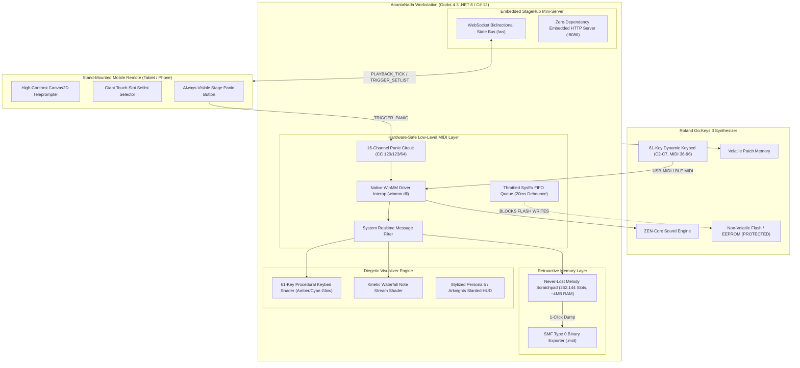

# ANANTANADA: Hybrid Workstation & Stage Console
### Dedicated Performance Engine & Stylized Diegetic Stage Console for Roland Go:Keys 3 (61-Key Synthesizer/Arranger)

[](https://godotengine.org)
[](https://www.roland.com/global/products/gokeys_3/)
[-00f5d4)](#-hardware-safety-principles)
[](#-embedded-stagehub-telemetry-server)

> **Design Paradigm:** Game-Grade Diegetic Stage Console (*Persona 5* / *Arknights* / *Hi-Fi Rush*)  
> **Host Runtime:** Godot Engine 4.3 (.NET 8 / C# 12)  
> **Companion Client:** Embedded Local HTTP & WebSocket Server + HTML5 / Canvas2D Remote  
> **Remote Repository:** [https://github.com/y7thangeru/AnantaNada](https://github.com/y7thangeru/AnantaNada)

---

## 🌟 Architecture & Core Guarantees



---

## 🛡️ Hardware Safety Principles (Roland Go:Keys 3)

1. **Zero Non-Volatile Flash Writes (`SelectPatchVolatile`)**:
   - Tone navigation executed exclusively via volatile standard MIDI messaging:
     - Bank Select MSB (`CC 00`)
     - Bank Select LSB (`CC 32`)
     - Program Change (`PC 0-127`)
   - Internal keyboard EEPROM / system flash memory is strictly untouched, guaranteeing zero flash endurance wear during intensive live performances.

2. **Throttled SysEx FIFO Queue (`MidiConstants.SysExDebounceMs = 20ms`)**:
   - Outbound SysEx dumps are paced by a dedicated background worker thread with a strict 20ms debounce limiter, preventing processor buffer overflows on the Roland instrument.

3. **Global Panic Failsafe Circuit**:
   - Immediate emergency broadcast of `CC 120` (All Sound Off), `CC 123` (All Notes Off), and `CC 64` (Sustain Off = 0) across all 16 MIDI channels.
   - Clears hanging or stuck notes within 1 millisecond if USB cables are accidentally disconnected or Bluetooth LE MIDI suffers packet dropouts.

4. **Zero-Allocation Hot Path**:
   - Direct P/Invoke integration with `winmm.dll` using pinned delegate callbacks and value-type `MidiRawMessage` structs. Zero heap allocations during live performance.

---

## 🧠 "Never-Lost Melody" Retroactive Scratchpad

- Continuously buffers all incoming MIDI events in a lock-free circular ring buffer (262,144 event slots, consuming ~4 MB of RAM).
- Stores up to 5 minutes of continuous playing history with microsecond-accurate hardware timestamps.
- **1-Click Export**: Tapping *"Ambil Ide Tadi"* immediately serializes the buffer into a valid Standard MIDI File (`.mid`, SMF Type 0) with automatic resolution of hanging notes and variable-length quantity (VLQ) delta times.

---

## 📱 Embedded StageHub & Teleprompter

- Built-in zero-dependency HTTP and WebSocket server running inside the Godot .NET host on port `8080`.
- Connect any stand-mounted smartphone or tablet over local Wi-Fi or mobile hotspot.
- Displays auto-scrolling chord charts, metronome pulses, current/next chord lookahead, giant touch setlist slots, and an emergency panic button.

---

## 📁 Multi-Tiered Directory Architecture

```text
AnantaNada_RolandGoKeys3/
├── scenes/
│   ├── MainStageView.tscn              # Godot 4 main stage scene & stylized node hierarchy
│   └── README.md                       # Documentation for scene hierarchy and HUD layout
├── src/
│   ├── Core/
│   │   └── Midi/
│   │       ├── MidiConstants.cs        # Roland Go:Keys 3 CC numbers, status bytes & safety timings
│   │       ├── NativeMidiEngine.cs     # Zero-allocation WinMM interop, SysEx FIFO & Panic circuit
│   │       ├── RetroactiveBuffer.cs    # Lock-free 5-min RAM ring buffer & SMF Type 0 exporter
│   │       └── README.md               # Documentation for Core MIDI math & native drivers
│   ├── Network/
│   │   ├── StageHubServer.cs           # Embedded HTTP & WebSocket server for stage remote
│   │   ├── TelemetryContracts.cs       # Strong-typed JSON contracts (PLAYBACK_TICK, etc.)
│   │   └── README.md                   # Documentation for network topology & data contracts
│   ├── Shaders/
│   │   ├── piano_keybed.gdshader       # 61-Key procedural keybed shader with velocity glow
│   │   ├── waterfall_visualizer.gdshader # High-energy kinetic falling notes shader
│   │   └── README.md                   # Documentation for GPU shader mathematics & uniforms
│   ├── UI/
│   │   ├── MainStageController.cs      # Main Godot UI controller node connecting engine to scene
│   │   └── README.md                   # Documentation for controller lifecycle & state textures
│   ├── Tests/
│   │   └── VerificationHarness.cs      # Self-auditing unit verification suite
│   └── Program.cs                      # Host bootstrap entry point
├── web/
│   ├── index.html                      # Mobile teleprompter & setlist HUD
│   ├── style.css                       # Stylized high-contrast dark theme
│   ├── app.js                          # WebSocket client & teleprompter canvas renderer
│   └── README.md                       # Documentation for mobile remote client
├── captures/                           # Output directory for retroactive .mid exports
├── project.godot                       # Godot 4.3 project configuration
├── AnantaNada.csproj                   # .NET 8 / C# 12 project file with GodotSharp integration
├── ANANTANADA_SPEC.md                  # Comprehensive architectural specification
├── Feature-ToBe-Implemented.md         # Single source of truth for feature tracking
├── update_tracker.md                   # Audit log of all file changes and rationale
└── Report-To-GeminiProject.md          # Consolidated master report for Gemini project threads
```

---

## 🚀 Quickstart & Verification

### 1. Verify C# Engine & Hardware Protection Subsystems
```powershell
dotnet run
```
Executes the automated `VerificationHarness` validating:
- Retroactive circular RAM buffer write/read integrity (1,000 events)
- SMF Type 0 binary chunk header (`MThd`) and track chunk (`MTrk`) compliance
- Hardware-safe volatile tone switching (zero flash writes)
- 16-channel Panic Circuit broadcast

### 2. Launch with Godot 4 Engine
1. Open **Godot Engine 4.3+ (.NET edition)**.
2. Click **Import** and select `project.godot`.
3. Press **F5** (or Run `res://scenes/MainStageView.tscn`).

### 3. Connect Stand-Mounted Mobile Device
1. Connect smartphone or tablet to the same Wi-Fi or laptop hotspot.
2. Open browser and navigate to:
   ```text
   http://<HOST_IP>:8080
   ```
3. Live chord teleprompter, touch setlist switcher, and emergency panic button are instantly synchronized.
