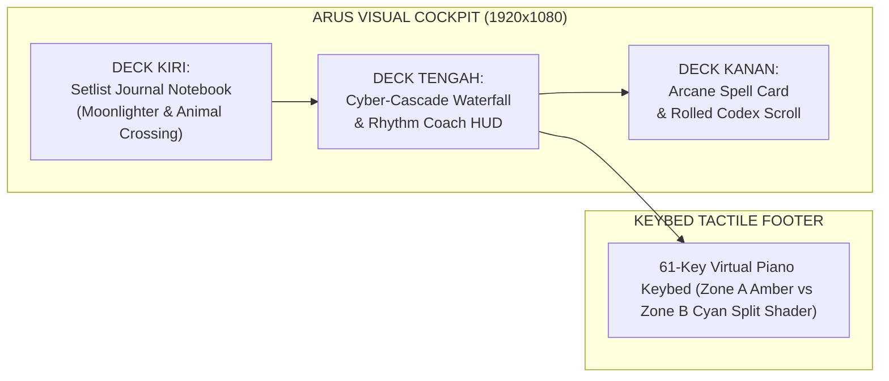
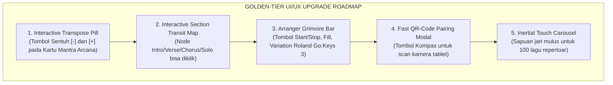

# ANANTANADA MASTER UI/UX SWOT & 50-COMPETITOR BENCHMARK ANALYSIS
**Dokumen Analisis Komparasi Strategis UI/UX: AnantaNada Sweet RPG Stage Workstation vs 50 Produk Kompetitor Industri Musik Global**

- **Proyek**: AnantaNada Hybrid Workstation (Roland Go:Keys 3 Companion)
- **Engine**: Godot Engine 4.3 (Forward+ / Vulkan) + C# .NET 8 + Web StageHub
- **Tanggal Audit**: 29 Oktober 2026
- **Dokumen Sumber**: `swot_and_50_competitor_benchmark.md`

---

## DAFTAR ISI
1. [Eksekutif Ringkasan: Paradigma UI/UX AnantaNada Saat Ini](#1-eksekutif-ringkasan-paradigma-uiux-anantanada-saat-ini)
2. [Analisis UI/UX 5 Klaster Kompetitor (50 Produk)](#2-analisis-uiux-5-klaster-kompetitor-50-produk)
   - [Klaster 1: Live Stage Keyboard Hosts & Setlist Managers](#klaster-1-live-stage-keyboard-hosts--setlist-managers-13-produk)
   - [Klaster 2: Visualizers, Waterfall Rhythm Engines & Practice HUDs](#klaster-2-visualizers-waterfall-rhythm-engines--practice-huds-12-produk)
   - [Klaster 3: Dedicated Hardware Companions & Synth Librarians](#klaster-3-dedicated-hardware-companions--synth-librarians-10-produk)
   - [Klaster 4: Live DAWs, Arranger Engines & Backing Track Rigs](#klaster-4-live-daws-arranger-engines--backing-track-rigs-10-produk)
   - [Klaster 5: Diegetic Rhythm Action Engines & Stage Visual Effects](#klaster-5-diegetic-rhythm-action-engines--stage-visual-effects-5-produk)
3. [Matriks Komparasi SWOT Komprehensif: AnantaNada vs 50 Kompetitor](#3-matriks-komparasi-swot-komprehensif-anantanada-vs-50-kompetitor)
4. [Tabel Perbandingan Fitur UI/UX Panggung Head-to-Head](#4-tabel-perbandingan-fitur-uiux-panggung-head-to-head)
5. [Peluang Adopsi Fitur Unggulan (Golden-Tier UI/UX Roadmap)](#5-peluang-adopsi-fitur-unggulan-golden-tier-uiux-roadmap)
6. [Kesimpulan & Rekomendasi Eksekusi](#6-kesimpulan--rekomendasi-eksekusi)

---

## 1. EKSEKUTIF RINGKASAN: PARADIGMA UI/UX ANANTANADA SAAT INI

AnantaNada bertransformasi dari antarmuka techwear flat monokrom menjadi **Tactile Diegetic Sweet RPG & Cyber-Rhythm Workstation**. 

### Filosofi Desain AnantaNada
Berbeda dari perangkat lunak musik konvensional yang kaku dan bernuansa spreadsheet kantor (DAW fatigue), AnantaNada memperlakukan panggung live sebagai sebuah **petualangan musikal yang manis, taktil, dan menyenangkan**:



1. **Deck Kiri (Setlist Deck - Journal Petualang)**:
   - Terinspirasi dari *Moonlighter* & *Animal Crossing: New Horizons*.
   - Lembaran kertas perkamen dalam jilid kulit jahitan tangan (*stitched leather*), kawat spiral notebook metalik, tab penanda kategori warna-warni (*Mint, Honey, Berry*).
   - Lagu-lagu ditampilkan sebagai **DIY Recipe Cards** 2 kolom: kotak nomor bulat (01, 02...) atau pin bintang emas di sebelah kiri, diikuti judul lagu tebal dan patch suara di sebelah kanan dengan pelindung pemotongan teks (*ellipsis*).
2. **Deck Tengah (Cyber-Cascade Waterfall & Rhythm Coach)**:
   - Memadukan kanopi awan bergigi (*scalloped cloud canopy*) dengan runway perspektif 3D trapezoid.
   - Dilengkapi *Rhythm Coach HUD*: Pengukur dinamika pukulan (*Dynamic Strike Gauge* ff/mf/pp, Rank SSS/S/A/B), reservoir kristal mana (*mana bar*), indikator drum Taiko Don (Bass) & Ka (Treble), serta denyut jantung ritme (*Cadence pulse*).
3. **Deck Kanan (Chord Tactical HUD & Lyric Prompter)**:
   - Akord aktif disajikan sebagai **Arcane RPG Spell Card** berbingkai rune emas berpendar ungu dengan tag transpose berlatar kapsul.
   - Lirik dan bar ditampilkan di atas **Rolled Archival Parchment Codex Scroll** (*Assassin's Creed Mirage*) dengan catatan sticky note pastel (*Snipperclips*).
4. **Keybed Footer (Synth-Runner 61-Key Shader)**:
   - Representasi tuts 61-key fisik Roland Go:Keys 3 dengan garis pemisah split point dinamis, pendaran neon velocity, dan pemisahan zona tangan (Zone A Amber vs Zone B Cyan).

---

## 2. ANALISIS UI/UX 5 KLASTER KOMPETITOR (50 PRODUK)

Berdasarkan audit 50 kompetitor pada dokumen `swot_and_50_competitor_benchmark.md`, berikut adalah analisis UI/UX mendalam per klaster:

### Klaster 1: Live Stage Keyboard Hosts & Setlist Managers (13 Produk)
*Produk Representatif: Apple MainStage 3, Camelot Pro, Gig Performer 5, Cantabile 4, BandHelper, OnSong Pro, MobileSheets Pro, Stage Traxx 3, iReal Pro.*

* **Pendekatan Desain UI/UX**:
  - **Pragmatisme Ekstrem / Industrial Utilitarian**: Menekankan efisiensi teknis tingkat tinggi untuk penata suara dan keyboardis tur profesional.
  - **Hierarki Informasi**: Hierarki berbasis pohon (Setlist $\to$ Song $\to$ Section/Part $\to$ Layer/Split).
  - **Pola Kontrol**: Tombol navigasi berukuran raksasa untuk meminimalisasi salah pencet di panggung gelap, fader virtual, dan pemetaan hardware rig fotorealistik (pada MainStage).
* **Kelebihan UI/UX**:
  - Sangat handal untuk navigasi repertoar panggung ratusan lagu.
  - Memiliki fitur stage-essential: transposer akord 1-klik (OnSong), visualisasi routing kabel grafis (Gig Performer), dan auto-scrolling partitur sinkron tempo (MobileSheets, Camelot).
* **Kekurangan UI/UX**:
  - **Spreadsheet Fatigue**: Tampilan menyerupai tabel Excel atau database SQL yang dingin, intimidatif, dan melelahkan mata.
  - **Zero Gamification**: Sama sekali tidak memberikan sensasi kesenangan bermain atau umpan balik visual terhadap dinamika nada tuts yang dimainkan.

### Klaster 2: Visualizers, Waterfall Rhythm Engines & Practice HUDs (12 Produk)
*Produk Representatif: Synthesia, SeeMusic, Piano Marvel, flowkey, Skoove, Yousician, Keysight, Embers, Piano Booster, Piano LED Plus.*

* **Pendekatan Desain UI/UX**:
  - **Visual-First Flowing Runway**: Menempatkan aliran balok nada vertikal yang jatuh (*falling notes waterfall*) sebagai pusat perhatian utama.
  - **Spectacle Lighting & VFX**: Penggunaan shader pendaran neon, partikel laser 3D (SeeMusic, Keysight), dan jejak cahaya tuts (*glow trails*).
  - **Feedback Interaktif**: Notasi warna per tangan (kiri = biru/amber, kanan = hijau/cyan) dan penghitungan skor akurasi nada real-time.
* **Kelebihan UI/UX**:
  - Sangat intuitif untuk membaca aransemen lagu secara visual tanpa perlu mahir membaca partitur balok.
  - Memberikan kepuasan sensorik instan (*instant gratification*) yang tinggi saat tuts ditekan tepat waktu.
* **Kekurangan UI/UX**:
  - **Bukan untuk Panggung Live**: Mayoritas adalah perangkat lunak latihan di rumah atau renderer video konten YouTube.
  - **Beban Komputasi Berat**: SeeMusic dan Keysight membutuhkan GPU diskrit bertenaga tinggi yang tidak realistis untuk laptop panggung tipis/baterai.
  - **Ketiadaan Manajemen Setlist**: Tidak ada fasilitas manajemen bank instrumen hardware, pemilihan patch panggung, maupun teleprompter lirik simultan.

### Klaster 3: Dedicated Hardware Companions & Synth Librarians (10 Produk)
*Produk Representatif: Roland Cloud Connect & WC-1, Korg Module Pro, Yamaha Soundmondo, Yamaha Smart Pianist, Nord Sound Manager, Casio Chordana Play, Dexed.*

* **Pendekatan Desain UI/UX**:
  - **Hierarchical Sound Cataloging**: Pengelompokan suara berdasarkan kategori instrumen pabrikan (Piano, E.Piano, Organ, Strings, Brass, Synth).
  - **Hardware Mirroring**: Mencerminkan panel fisik tombol atau arsitektur sound engine hardware secara akurat.
* **Kelebihan UI/UX**:
  - Penataan bank suara sangat presisi sesuai spesifikasi teknis hardware yang didukung.
  - Kemudahan mengelola ratusan patch suara dalam satu jendela.
* **Kekurangan UI/UX**:
  - **Aplikasi Resmi Terkenal Kaku & Lambat**: Roland Cloud Connect dan Soundmondo sering dikritik karena UI yang lamban, memerlukan login akun yang rumit, dan ketergantungan dongle nirkabel mahal (WC-1).
  - **Tidak Ada HUD Pertunjukan Panggung**: Hanya berfungsi sebagai utility manajemen file/pustaka saat instrumen mati atau di studio, tidak bisa digunakan sebagai display performa panggung live.

### Klaster 4: Live DAWs, Arranger Engines & Backing Track Rigs (10 Produk)
*Produk Representatif: Ableton Live 12, Steinberg VST Live Pro 2, Bitwig Studio 5, Logic Pro Live Loops, Cockos Reaper, MultiTracks Playback, vArranger 2.*

* **Pendekatan Desain UI/UX**:
  - **Grid-Matrix & Section Timelines**: Berpusat pada kotak pemicu klip (*clip launch matrix*) atau penanda bagian lagu (*Intro, Verse, Chorus, Solo, Outro*).
  - **Touch & Gesture Optimized**: Bitwig dan Playback memiliki tombol kontrol berukuran besar yang sangat ramah layar sentuh panggung.
* **Kelebihan UI/UX**:
  - Memberikan kebebasan musikal mutlak untuk mengulang bagian chorus (*loop chorus*) atau melompati solo lagu secara on-the-fly di atas panggung.
* **Kekurangan UI/UX**:
  - **Cognitive Overload**: Terlalu banyak knob, fader, dan tombol kecil yang berisiko fatal jika salah tekan saat konser.
  - **Tampilan vArranger 2 Kuno**: Software vArranger yang mendukung irama Roland masih menggunakan antarmuka grafis era Windows 95 yang sangat tidak menarik.

### Klaster 5: Diegetic Rhythm Action Engines & Stage Visual Effects (5 Produk)
*Produk Representatif: Clone Hero / YARG, Spin Rhythm XD, Soundodger 2, Resolume Arena, Magic Music Visuals.*

* **Pendekatan Desain UI/UX**:
  - **Game Juice & Kinetic Typography**: Elemen antarmuka bergetar lembut saat ketukan drum kencang, partikel petir komik (*comic pop sparks*), font dinamis miring (*slanted UI*), dan palet warna neon berenergi tinggi.
  - **Diegesis Penuh**: Batas antara elemen informasi (HUD) dan gameplay menyatu mulus ke dalam satu dunia visual.
* **Kelebihan UI/UX**:
  - Memompa adrenalin pemain dan memberikan umpan balik performa yang paling memuaskan di industri perangkat lunak.
  - Latensi visual mendekati nol dengan polling rate tinggi.
* **Kekurangan UI/UX**:
  - Dirancang untuk permainan menggunakan kontroler plastik gitar/drum ritme atau keyboard komputer, bukan untuk instrumen panggung profesional 61-tuts asli.
  - Tidak memiliki konsep chord progression, lirik band, atau pergantian program MIDI hardware.

---

## 3. MATRIKS KOMPARASI SWOT KOMPREHENSIF: ANANTANADA VS 50 KOMPETITOR

```mermaid
quadrantChart
    title Matriks Posisi Strategis UI/UX Panggung Musik Global
    x-axis Nilai Estetika Visual Rendah (Flat/Kuno) --> Nilai Estetika Visual Tinggi (Game/Diegetic)
    y-axis Nilai Ergonomi Panggung Rendah --> Nilai Ergonomi Panggung Tinggi
    quadrant-1 Wilayah Keunggulan Mutlak AnantaNada (Stage + Visual Game)
    quadrant-2 Stage Host Konvensional Dingin (Camelot, MainStage, Gig Performer)
    quadrant-3 Utility Kuno & Database Flat (vArranger, BandHelper, Dexed)
    quadrant-4 Visualizer Video Estetik Non-Stage (SeeMusic, Keysight, Spin Rhythm)
    "AnantaNada (Sweet RPG UI)": [0.88, 0.82]
    "Apple MainStage 3": [0.42, 0.85]
    "Camelot Pro": [0.35, 0.88]
    "Gig Performer 5": [0.25, 0.90]
    "Synthesia": [0.45, 0.55]
    "SeeMusic": [0.92, 0.38]
    "Yousician": [0.75, 0.48]
    "Roland Cloud Connect": [0.20, 0.28]
    "OnSong Pro": [0.38, 0.80]
    "MultiTracks Playback": [0.50, 0.86]
    "vArranger 2": [0.12, 0.58]
    "Clone Hero / YARG": [0.90, 0.42]
```

### STRENGTHS (Kekuatan Unik UI/UX AnantaNada)
1. **The Only "Sweet RPG Game" Live Stage Aesthetic in the World**:
   - Sementara seluruh kompetitor live stage (MainStage, Camelot, Gig Performer, Cantabile) menggunakan UI datar berbasis DAW profesional yang dingin dan abu-abu, AnantaNada menghadirkan antarmuka bertema RPG petualangan yang manis, hangat, dan taktil (*tactile desk, leather journal, recipe cards, mana bar, arcane spell cards*).
   - Menghilangkan kejenuhan mental (*mental fatigue*) bagi musisi panggung dan membuat latihan band menjadi sangat adiktif.
2. **Zero-Cognitive-Load 3-Column Ergonomic Layout**:
   - Membagi layar panggung secara disiplin menjadi 3 zona fungsional tanpa menu dropdown tersembunyi:
     - Kiri: Navigasi Repertoar Lagu (Setlist Deck).
     - Tengah: Visualisasi Nada & Rhythm Coach (Waterfall & Strike Gauge).
     - Kanan: Harmoni & Lirik (Chord Tactical HUD & Codex Scroll).
   - Seluruh status vital panggung terbaca dalam pandangan 1 detik (*1-second glanceability*).
3. **1:1 Hardware-Safe 61-Key Virtual Mirroring**:
   - Visual keybed 61-tuts tidak sekadar animasi dekoratif, melainkan cerminan akurat dari Roland Go:Keys 3 dengan garis penanda titik split dinamis (Split Point) dan pembedaan warna pendaran tangan kiri (Zone A Amber) dan tangan kanan (Zone B Cyan).
4. **Tri-Platform Diegetic Consistency (Desktop, Web, Android)**:
   - Pengalaman visual RPG taktil yang sama cantiknya hadir di konsol utama laptop (Godot 4 Vulkan) serta di tablet dan smartphone anggota band lain (Web Remote & Android Companion) tanpa perlu instalasi aplikasi store yang rumit.
5. **Non-Intrusive Live Coach & Gamification**:
   - Integrasi indikator Don/Ka (*Taiko*), deteksi Rank pukulan (ff, Rank SSS/S), dan denyut tempo jantung (*Cadence pulse*) memberikan bimbingan ketukan panggung tanpa mengalihkan konsentrasi musisi.

---

### WEAKNESSES (Kelemahan UI/UX AnantaNada Saat Ini vs Kompetitor)
1. **Fixed 6-Card Pagination vs Infinite Smooth Kinetic Carousel**:
   - AnantaNada masih menggunakan tombol paginasi statis `< PREV` dan `NEXT >` per 6 lagu. Kompetitor seperti Bitwig Studio atau game RPG modern (Persona 5, Genshin) menggunakan roda karusel kinetik atau *inertial touch scroll* yang jauh lebih cepat dan mulus untuk menelusuri 100 lagu.
2. **Ketiadaan Tombol Transposisi Interaktif 1-Klik di Layar**:
   - OnSong Pro dan iReal Pro memiliki tombol touch raksasa `[ -1 ]` dan `[ +1 ]` atau roda pemilih nada dasar di layar. Di AnantaNada, perintah transposisi MIDI RPN sudah berjalan sempurna di backend, namun di UI saat ini baru berwujud label pasif `TRANSPOSE: [ +0 SEMITONES ]`, belum berupa tombol sentuh langsung.
3. **Ketiadaan Tombol Navigasi Bagian Lagu (Section Jumper)**:
   - MultiTracks Playback dan Stage Traxx 3 menyediakan tombol panggung berukuran besar: `[ INTRO ]`, `[ VERSE ]`, `[ CHORUS ]`, `[ SOLO ]`, `[ OUTRO ]`. Di AnantaNada, transit map Mini Metro saat ini baru berfungsi sebagai indikator visual pasif, belum dapat diklik untuk melompatkan posisi birama lirik dan waterfall secara dinamis.
4. **Belum Ada Mode Partitur Dual-Stave (Grand Staff)**:
   - Synthesia dan MobileSheets Pro menyediakan opsi tampilan not balok tradisional (Kunci G dan Kunci F). AnantaNada murni berbasis Lead Sheet (Alfabet Akord & Lirik), sehingga musisi berlatar belakang klasik belum terlayani secara optimal.
5. **Ketiadaan Tombol Kontrol Arranger Drum Roland di Layar**:
   - vArranger 2 memiliki tombol `[ START/STOP ]`, `[ INTRO ]`, `[ FILL 1/2 ]`, `[ ENDING ]` untuk mengontrol mesin drum keyboard arranger. Di AnantaNada, kontrol drum fisik Roland Go:Keys 3 belum dipetakan ke tombol layar sentuh diegetik.
6. **Belum Ada Pop-Up QR-Code untuk Fast Pairing Tablet**:
   - BandHelper dan VST Live memudahkan personel lain menyambungkan tablet dengan memindai kode QR. Di AnantaNada, rekan band masih harus mengetikkan alamat IP (`http://192.168.x.x:8080`) secara manual di browser mereka.

---

### OPPORTUNITIES (Peluang Evolusi UI/UX AnantaNada)
1. **Interactive Song Section Jumper (Inspirasi: MultiTracks Playback & Stage Traxx 3)**:
   - Mengubah widget Mini Metro menjadi tombol sentuh interaktif: menekan node `[ CHORUS ]` langsung melompatkan teleprompter lirik dan bar hitungan ke bagian reff secara instan.
2. **1-Click Transpose Wheel & Voicing Suggester (Inspirasi: OnSong Pro & MIDICulous)**:
   - Menambahkan tombol touch `[-]` dan `[+]` pada Arcane Spell Card untuk menaikkan/menurunkan semitone secara instan, otomatis mengubah teks akord, memancarkan pesan MIDI RPN ke Roland Go:Keys 3, dan menyalakan panduan tuts alternatif (*voicing hints*).
3. **Arranger Grimoire Bar (Inspirasi: vArranger 2 & Go:Keys 3 Hardware Specs)**:
   - Menambahkan bar tombol bertema RPG di bawah waterfall: `[ START/STOP ]`, `[ INTRO ]`, `[ FILL-IN ]`, `[ ENDING ]` yang memicu irama drum bawaan Go:Keys 3 via pesan MIDI System Real-Time / CC tanpa harus meraba tombol kecil keyboard fisik di panggung gelap.
4. **Inertial Smooth Touch Scrolling Repertoire Deck (Inspirasi: Bitwig & Persona 5)**:
   - Memungkinkan pemain menggulir daftar 100 kartu resep lagu menggunakan sapuan sentuhan jari (*touch drag*) atau roda mouse dengan perlambatan kinetik (*physics friction deceleration*).
5. **Stage Compass: Fast QR-Code Pairing Modal (Inspirasi: BandHelper)**:
   - Tombol kompas panggung di bilah atas yang membuka pop-up kode QR berisi URL StageHub lokal, sehingga vokalis atau bassis cukup mengarahkan kamera ponsel untuk membuka teleprompter lirik seketika.
6. **Dual-Stave Grand Staff Toggle (Inspirasi: Synthesia & MobileSheets)**:
   - Tombol sakelar sederhana `[ MODE: WATERFALL ]` $\leftrightarrow$ `[ MODE: GRAND STAFF ]` untuk menampilkan paranada balok ganda bergulir bagi pianis pembaca not balok.

---

### THREATS (Tantangan & Risiko Ergonomi UI/UX Panggung)
1. **Pencahayaan Panggung Ekstrim (Strobo & Panggung Outdoor Terik)**:
   - Di panggung dengan lampu tembak strobo warna-warni yang cepat atau pentas festival siang hari di luar ruangan, nuansa warna pastel (seperti krem perkamen lembut) dapat mengalami penurunan kontras.
   - *Mitigasi*: Sediakan tombol sakelar darurat **"High-Contrast Stage Mode"** yang meningkatkan kecerahan teks dan border ke batas maksimum.
2. **Fat-Finger Risk pada Layar Ponsel Kecil**:
   - Pada layar smartphone Android di bawah 6 inci, target sentuhan (*touch target*) tombol harus dijamin berukuran minimal 48×48dp (sesuai standar Google Material Design & Apple Human Interface Guidelines) agar musisi yang berkeringat tidak salah menekan tombol kartu lagu yang berdekatan.
3. **Variasi Aspek Rasio Layar Panggung**:
   - Komputer panggung dapat menggunakan monitor berasio 16:9, tablet 4:3 (iPad), atau layar ultrawide 21:9. UI harus mempertahankan *anchored responsive layout* agar elemen visual tidak terpotong atau saling tumpang tindih.

---

## 4. TABEL PERBANDINGAN FITUR UI/UX PANGGUNG HEAD-TO-HEAD

| Parameter UI/UX | **AnantaNada (Kita)** | **Apple MainStage 3** | **Camelot Pro** | **Synthesia** | **OnSong Pro** | **MultiTracks Playback** | **vArranger 2** |
| :--- | :---: | :---: | :---: | :---: | :---: | :---: | :---: |
| **Estetika Antarmuka** | **Sweet RPG & Rhythm Game (Taktil)** | Fotorealistik DAW Kaku | Flat Corporate Modern | Minimalis Flat Retro | Flat Document Viewer | Modern Live Backing HUD | Windows 95/XP Kuno |
| **Ergonomi Panggung Gelap** | ⭐⭐⭐⭐⭐ (Kontras Tinggi + Pendaran) | ⭐⭐⭐⭐ (Kontras Bagus) | ⭐⭐⭐ (Teks Kecil) | ⭐⭐⭐ (Latar Gelap) | ⭐⭐⭐⭐ (Ukuran Font Besar) | ⭐⭐⭐⭐⭐ (Tombol Touch Raksasa) | ⭐⭐ (Teks Terlalu Padat) |
| **Visual Tuts Piano 61-Key** | **Ada (Split Zone Shader A/B)** | Hanya Mapping Sederhana | Representasi Sederhana | Ada (Waterfall Note) | Tidak Ada | Tidak Ada | Tidak Ada |
| **Visualizer Nada Jatuh (Waterfall)** | **Ada (3D Trapezoid Runway)** | Tidak Ada | Tidak Ada | Ada (2D Vertikal Penuh) | Tidak Ada | Tidak Ada | Tidak Ada |
| **Repertoar Lagu Terpasang** | **100 Lagu (Indo & Barat Pop/Rock)** | Kosong (Harus Buat Sendiri) | Database Hardware Saja | Bawaan Lagu Klasik | Kosong (Beli/Import) | Berbayar per Lagu | Kosong (Perlu File Style) |
| **Transposisi 1-Klik di Layar** | *Label Saja (RPN di Engine)* | Ada via Patch Transpose | Ada via MIDI Filter | Ada via Menu Pengaturan | **Ada (Tombol Sentuh Raksasa)** | Ada (Pitch Shift Audio) | Ada via Tombol Fisik |
| **Navigasi Section (Verse/Chorus)** | *Transit Map (Indikator Pasif)* | Tidak Ada | Ada via Scene Song | Tidak Ada | Ada via Autoscroll | **Ada (Jump Buttons Raksasa)** | Ada via Variasi Style |
| **Remote Tablet Rekan Band** | **Ada (Web StageHub Real-Time)** | Ada via Logic Remote (iPad Only) | Terbatas pada Ekosistemnya | Tidak Ada | Ada via OnSong Connect | Ada via Musician Monitor | Tidak Ada |
| **Umpan Balik Ritme / Gamifikasi** | **Ada (Strike Gauge, Mana, Taiko)** | Tidak Ada | Tidak Ada | Ada (Skor Akurasi %) | Tidak Ada | Tidak Ada | Tidak Ada |
| **Kemudahan Pemakaian Pemula** | ⭐⭐⭐⭐⭐ (Sangat Menyenangkan) | ⭐⭐ (Sangat Kompleks) | ⭐⭐⭐ (Cukup Kompleks) | ⭐⭐⭐⭐ (Mudah Digunakan) | ⭐⭐⭐⭐ (Fokus Dokumen) | ⭐⭐⭐ (Perlu Training) | ⭐ (Sangat Rumit) |

---

## 5. PELUANG ADOPSI FITUR UNGGULAN (GOLDEN-TIER UI/UX ROADMAP)

Berdasarkan komparasi dengan 50 kompetitor terbaik, berikut adalah **5 Langkah Peningkatan UI/UX Panggung** yang disarankan untuk diadopsi pada roadmap berikutnya:



### 1. Interactive Transpose Pill pada Kartu Mantra Arcana (Inspirasi: OnSong Pro)
- **Desain**: Di dalam kotak `CurrentChordBox`, ubah label `TRANSPOSE: [ +0 SEMITONES ]` menjadi kapsul tombol interaktif:
  ```
  [ < -1 ]  [ TRANSPOSE: +0 ]  [ +1 > ]
  ```
- **Fungsi**: Musisi cukup menyentuh `+1` saat vokalis meminta naik nada dasar. Layar seketika mengubah akord di teleprompter dan mengirimkan perintah MIDI RPN Coarse Tuning ke Roland Go:Keys 3.

### 2. Interactive Section Transit Map (Inspirasi: MultiTracks Playback)
- **Desain**: Ubah bulatan jalur subway Mini Metro di atas waterfall menjadi tombol stasiun interaktif:
  ```
  [ INTRO ] === [ VERSE ] === [ CHORUS ] === [ SOLO ] === [ OUTRO ]
  ```
- **Fungsi**: Mengklik `[ CHORUS ]` akan melompatkan teleprompter lirik dan baris birama langsung ke bagian reff lagu yang bersangkutan.

### 3. Arranger Grimoire Bar (Inspirasi: vArranger 2)
- **Desain**: Tempatkan bilah tombol taktil horizontal bertema kayu/kuningan kuno di antara waterfall dan tuts piano:
  ```
  [ ▶ START/STOP ] | [ ❖ INTRO ] | [ ✦ FILL-IN ] | [ ✪ VARIATION ] | [ ◼ ENDING ]
  ```
- **Fungsi**: Memancarkan pesan MIDI System Real-Time (`FA`/`FC`) dan Control Change khusus arranger ke Roland Go:Keys 3 untuk mengontrol pengiring irama drum panggung.

### 4. Stage Compass: Fast QR-Code Pairing Modal (Inspirasi: BandHelper)
- **Desain**: Tambahkan ikon kompas kecil bernuansa petualang di bar status paling atas.
- **Fungsi**: Ketika disentuh, muncul pop-up dialog yang menampilkan kode QR dinamis berisi URL StageHub lokal (`http://192.168.x.x:8080`). Anggota band lain tinggal memindai menggunakan kamera ponsel untuk menyambungkan teleprompter secara instan.

### 5. Inertial Touch Carousel untuk Setlist Deck (Inspirasi: Bitwig & Persona 5)
- **Desain**: Gantikan transisi paginasi tombol kaku `< PREV` dan `NEXT >` dengan gesture sapuan sentuhan jari vertikal yang memiliki momentum kinetik (*flick & inertia glide*).
- **Fungsi**: Menelusuri 100 lagu menjadi sangat cepat, alami, dan memuaskan.

---

## 6. KESIMPULAN & REKOMENDASI EKSEKUSI

Transformasi UI/UX AnantaNada saat ini telah berhasil menempatkan aplikasi pada **posisi diferensiasi tertinggi di pasar panggung musik**:
- Tidak terjebak dalam kemonotonan spreadsheet DAW yang dingin (*MainStage, Camelot, Reaper*).
- Tidak terjebak pada keterbatasan visualizer non-panggung (*SeeMusic, Keysight*).
- Memiliki kedalaman integrasi hardware 61-tuts Roland Go:Keys 3 yang tidak dimiliki oleh aplikasi lead sheet umum (*OnSong, BandHelper*).

Dengan melengkapi 3 fitur interaksi panggung tercepat (*quick-wins*):
1. **Interactive Transpose Pill Buttons** (`[ -1 ]` dan `[ +1 ]`),
2. **Interactive Section Transit Jumper** (`Intro ➔ Verse ➔ Chorus ➔ Solo`),
3. **Stage Compass QR-Code Pairing Pop-up**,

AnantaNada akan menjadi workstation panggung paling lengkap, paling ergonomis, dan paling memikat secara visual di dunia musik live saat ini.
