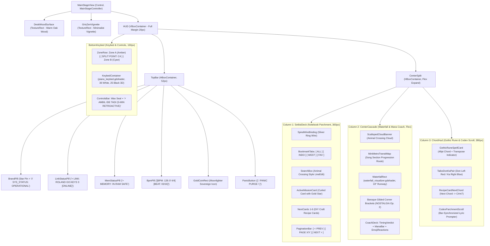

# Godot 4 Diegetic Stage Scene Hierarchy (`scenes/`)

### Stage Console Scene Layout & 3-Column Sweet RPG Atelier Structure

> **Engine:** Godot Engine 4.x (.NET & GDScript Bridge)  
> **Target Display Resolution:** Full HD ($1920 \times 1080$), Responsive Scaling (`canvas_items`, `keep_height`)  
> **Root Scene File:** `res://scenes/MainStageView.tscn`  
> **Attached Controller:** `src/UI/MainStageController.cs` (C#) / `src/UI/MainStageController.gd` (GDScript Bridge)  
> **Visual Showcase Artifacts:** `captures/screenshot_godot_stage.png`, `captures/screenshot_web_remote.png`, `captures/screenshot_android_companion.png`, `captures/ui_setlist_deck.png`, `captures/ui_waterfall_coach.png`, `captures/ui_chord_hud.png`, `captures/ui_keybed_61.png`

---

## 1. Visual Cockpit Architecture

The scene is designed as a diegetic gaming cockpit combining **Animal Crossing** DIY recipe cards & cloud canopy, **Stardew Valley** rustic wood joinery, **Tricky Towers** runic spell card frames, and **Hi-Fi Rush / DJMAX** rhythmic mana feedback.

---

## 2. Component Visual Breakdown

### 2.1. Column 1: Setlist Codex Deck (Spiral Notebook & Recipe Cards)

- **Node:** `HUD/CenterSplit/SetlistDeck`
- **Textures:** `assets/rpg_ui/sprites/notebook_page_parchment.png`, `assets/rpg_ui/sprites/spiral_wire_binding.png`, `assets/rpg_ui/sprites/card_ac_recipe_item.png`.
- **Features:** Bookmark tabs pastel (`[ ALL ]`, `[ INDO ]`, `[ WEST ]`), kotak pencarian instan, dan 100 kartu lagu resep DIY.

### 2.2. Column 2: Cyber-Cascade Waterfall & Performance Coach Deck

- **Node:** `HUD/CenterSplit/CenterCascade`
- **Textures & Shaders:** `scalloped_cloud_banner.png`, `widget_minimetro_transit_map.png`, `gauge_rpg_mana_bar.png`, `emoji_reaction_happy.png`, `waterfall_visualizer.gdshader`.
- **Features:** Hiasan kanopi awan, peta transit seksi lagu, runway 3D 18° dengan hit beam bloom, meteran akurasi metronom, dan reservoar mana kristal.

### 2.3. Column 3: Runic Harmony HUD & Codex Lyric Scroll

- **Node:** `HUD/CenterSplit/ChordHud`
- **Textures:** `card_rpg_spell_harmony.png`, `icon_taiko_don_ka_pair.png`, `card_ac_recipe_item.png`, `parchment_codex_scroll.png`.
- **Features:** Kartu mantra batu runik menaungi akord aktif 48pt, indikator drum Taiko Don/Ka, kartu resep akord berikutnya, dan gulungan perkamen naskah kuno lirik.

### 2.4. Bottom Bar: Synth-Runner 61-Key Keybed & Never-Lost Melody

- **Node:** `HUD/BottomKeybed`
- **Shader:** `src/Shaders/piano_keybed.gdshader` (36 tuts putih gading, 25 tuts hitam 3D terangkat, garis pemisah Split Point C4 merah, dual neon Amber/Cyan glow).
- **Controls:** Tombol ekspor rekaman 5 menit *"⚡ AMBIL IDE TADI"* dengan stempel segel lilin merah (*wax seal*).

---

## 3. Responsive Scaling & Projection
In `project.godot`:
- Viewport Size: $1920 \times 1080$ Full HD.
- Stretch Mode: `canvas_items`, Aspect: `keep_height`.
- Rendering Driver: Forward+ (Vulkan) / Compatibility.
