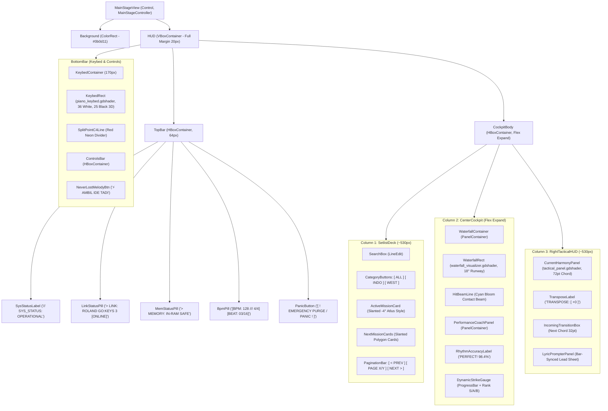

# Godot 4 Diegetic Stage Scene Hierarchy (`scenes/`)

### Stage Console Scene Layout & 3-Column Cockpit Component Structure

> **Engine:** Godot Engine 4.x (.NET & GDScript Bridge)  
> **Target Display Resolution:** Full HD ($1920 \times 1080$), Responsive Scaling (`canvas_items`, `keep_height`)  
> **Root Scene File:** `res://scenes/MainStageView.tscn`  
> **Attached Controller:** `src/UI/MainStageController.cs` (C#) / `src/UI/MainStageController.gd` (GDScript Bridge)  
> **Visual Showcase Artifacts:** `captures/screenshot_godot_stage.png`, `captures/ui_setlist_deck.png`, `captures/ui_waterfall_coach.png`, `captures/ui_chord_hud.png`, `captures/ui_keybed_61.png`

---

## 1. Visual Cockpit Architecture

The scene is designed as a diegetic gaming cockpit combining **Persona 5 / Metaphor** slanted cards, **Arknights** chamfered tactical HUD frames, and **Hi-Fi Rush** rhythmic feedback meters.

---

## 2. Component Visual Breakdown

### 2.1. Column 1: Tactical Setlist Deck (100-Song Repertoire)

- **Node:** `HUD/CockpitBody/SetlistDeck`
- **Features:** Real-time substring filter (`SearchBox`), Category tabs (`[ ALL (100) ]`, `[ INDO (50) ]`, `[ WEST (50) ]`), slanted mission cards with glowing hover states, and pagination controls (`< PREV` / `NEXT >`).

### 2.2. Column 2: Cyber-Cascade Waterfall & Performance Coach

- **Node:** `HUD/CockpitBody/CenterCockpit`
- **Shader:** `src/Shaders/waterfall_visualizer.gdshader` (18° trapezoidal 3D runway, 61 lane dividers, focused Hit Beam bloom).
- **Features:** Real-time timing coach measuring micro-rhythmic drift (`PERFECT!`, `GREAT!`, `RUSHING`, `DRAGGING`) and dynamic velocity strike gauge (`RANK [S]`, `RANK [A]`, `RANK [B]`).

### 2.3. Column 3: Tactical Chord HUD & Lyric Prompter

- **Node:** `HUD/CockpitBody/RightTacticalHUD`
- **Shader:** `src/Shaders/tactical_panel.gdshader` (Chamfered polygon corners, caution stripes).
- **Features:** Huge **72pt** current chord box readable from 2 meters, coarse transpose display, Cyan anticipatory next chord box with breathing pulse, and bar-synchronized lyric prompter.

### 2.4. Bottom Bar: Synth-Runner 61-Key Keybed & Never-Lost Melody

- **Node:** `HUD/BottomBar/KeybedContainer`
- **Shader:** `src/Shaders/piano_keybed.gdshader` (36 ivory white keys, 25 elevated 3D obsidian black keys, ambient occlusion drop shadows, Split Point C4 red line, dual Amber/Cyan neon glow).
- **Control:** 1-Click *"⚡ AMBIL IDE TADI"* exporting retroactive 5-minute RAM scratchpad to `.mid`.

---

## 3. Responsive Scaling & Resolution
In `project.godot`:
- Viewport Size: $1920 \times 1080$ Full HD.
- Stretch Mode: `canvas_items`, Aspect: `keep_height`.
- Rendering Driver: Forward+ (Vulkan) / Compatibility.
