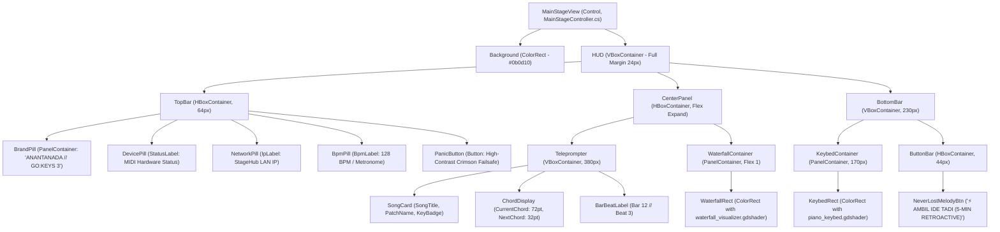

# Godot 4 Diegetic Stage Scene Hierarchy (`scenes/`)

### Stage Console Scene Layout & Visual Component Structure

> **Engine:** Godot Engine 4.x (.NET Edition)  
> **Target Display Resolution:** Full HD ($1920 \times 1080$), Responsive Scaling (`canvas_items`, `keep_height`)  
> **Root Scene File:** `res://scenes/MainStageView.tscn`  
> **Attached Controller:** `src/UI/MainStageController.cs`

---

## 1. Scene Graph & Node Hierarchy

The main stage view is structured as a layered diegetic HUD inspired by *Persona 5* slanted kinetic cards, *Arknights* tactical HUD elements, and *Hi-Fi Rush* rhythmic meters.

---

## 2. Visual Style & Color Design System

| Color Token | Hex Code | Purpose |
| :--- | :--- | :--- |
| **Deep Obsidian** | `#0b0d10` | Stage background canvas backing. |
| **Panel Charcoal** | `#161920` | Secondary container frames and cards. |
| **Electric Amber** | `#ffb703` | Left-hand key splits, metronome ticks, warm accents. |
| **Cyber Cyan** | `#00f5d4` | Right-hand key splits, strike beam, active chords. |
| **Warning Crimson**| `#ef233c` | Emergency hardware Panic button. |
| **Ivory White** | `#e5e8f0` | High-contrast readable typography for stage viewing. |

---

## 3. Responsive Scaling & Projection

In `project.godot`:
- `display/window/size/viewport_width = 1920`
- `display/window/size/viewport_height = 1080`
- `display/window/stretch/mode = "canvas_items"`
- `display/window/stretch/aspect = "keep_height"`

This configuration ensures crisp 2D shader execution and legible typography regardless of whether the console is projected on a high-DPI laptop screen, a $4\text{K}$ stage monitor, or an ultrawide performance display.
