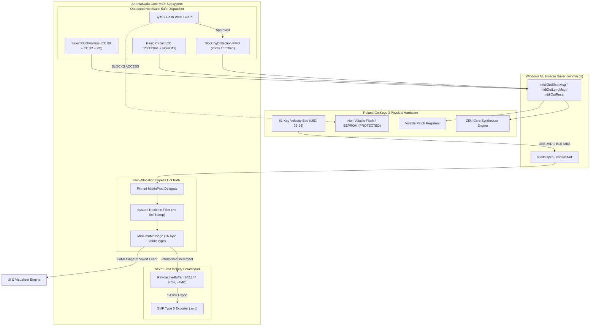

# Core MIDI Subsystem (`AnantaNada.Core.Midi`)

### Hardware-Safe Low-Level MIDI Engine & Retroactive Capture Buffer for Roland Go:Keys 3

> **Namespace:** `AnantaNada.Core.Midi`  
> **Platform Interop:** Windows Multimedia API (`winmm.dll`) / Cross-Platform Fallback  
> **Target Instrument:** Roland Go:Keys 3 (61-Key Arranger / Synthesizer, Note Range: $C_2 = 36$ to $C_7 = 96$)

---

## 1. Subsystem Architecture

The Core MIDI subsystem provides the low-level physical and logical communication layer between the host machine and the Roland Go:Keys 3 instrument.



---

## 2. Mathematical & Algorithmic Foundations

### 2.1. Lock-Free Circular Ring Indexing
The retroactive memory buffer allocates a static contiguous array of $N = 2^{18} = 262,144$ entries of `MidiEventRecord` structs (16 bytes each, consuming exactly 4,194,304 bytes of RAM). Because $N$ is an exact power of two, wrap-around pointer arithmetic eliminates the expensive integer modulo operator ($\%$) in favor of bitwise AND with a bitmask:

$$\text{IndexMask} = N - 1 = 262,143 = \text{0x3FFFF}$$

Given a monotonically increasing 64-bit atomic counter $H \in \mathbb{N}$ incremented via `Interlocked.Increment(ref _head)`:

$$\text{SlotIndex}(H) = (H - 1) \ \& \ \text{IndexMask}$$

This ensures that pushing new MIDI events never takes locks, causes zero thread contention, and generates zero garbage collector (GC) allocations on the hot path.

### 2.2. Standard MIDI File (SMF Type 0) Variable-Length Quantity (VLQ)
When serializing captured events to `.mid`, timestamps are converted from microsecond differences to MIDI tick deltas. Each delta-time is serialized as a 7-bit Variable-Length Quantity (VLQ):

$$\text{DeltaTicks} = \left\lfloor \frac{\Delta t_{\mu s}}{\text{TickDuration}_{\mu s}} \right\rceil$$

Where:
$$\text{TickDuration}_{\mu s} = \frac{60 \times 10^6}{\text{BPM} \times \text{PPQN}}$$

For $\text{BPM} = 120$ and $\text{PPQN} = 480$:
$$\text{TickDuration}_{\mu s} = \frac{60,000,000}{120 \times 480} = 1041.6\overline{6}\ \mu s/\text{tick}$$

The VLQ encoding extracts 7 bits per byte, with MSB ($b_7$) set to $1$ for all preceding bytes and $0$ for the terminating byte:

```csharp
private static void WriteVariableLengthQuantity(BinaryWriter writer, uint value)
{
    uint buffer = value & 0x7F;
    while ((value >>= 7) > 0)
    {
        buffer <<= 8;
        buffer |= 0x80;
        buffer += (value & 0x7F);
    }
    while (true)
    {
        writer.Write((byte)(buffer & 0xFF));
        if ((buffer & 0x80) != 0) buffer >>= 8;
        else break;
    }
}
```

### 2.3. Roland Go:Keys 3 61-Key Mapping & Polyphony Tracker
The physical keybed encompasses 5 octaves:
- Lowest Note: $C_2$ (MIDI Key Number $36$, Frequency $f \approx 65.41\text{ Hz}$)
- Highest Note: $C_7$ (MIDI Key Number $96$, Frequency $f \approx 2093.00\text{ Hz}$)
- Total Keys: 61 (36 Natural White Keys, 25 Accidental Black Keys)

The export engine maintains a dynamic active note set:
$$\text{NoteKey} = (\text{Channel} \ll 8) \mid \text{Data1}$$
When exporting retroactive sessions, any Note-On without a matching Note-Off is automatically terminated with a synthetic Note-Off event ($\text{Velocity} = 64$) at $\Delta t = 0$, guaranteeing that exported MIDI files never cause hanging notes in external DAWs (Ableton, FL Studio, Logic Pro, Reaper).

---

## 3. Hardware-Safe Guarantees for Roland Hardware

### 3.1. Zero Non-Volatile Flash Writes
- Standard external MIDI controllers or SysEx software can mistakenly send parameter store commands (`DT1` with flash sector headers) that burn changes to the keyboard's internal flash memory, causing flash endurance wear.
- `NativeMidiEngine` strictly uses volatile standard MIDI messages:
  1. `CC 00` (Bank Select MSB)
  2. `CC 32` (Bank Select LSB)
  3. `PC` (Program Change $0 \text{--} 127$)
- Patch changes take effect in Roland's volatile operational RAM instantly without touching EEPROM.

### 3.2. Rate-Limited SysEx FIFO Queue (20ms Debounce)
- Roland Go:Keys 3 microcontrollers can drop packets or lock up if flooded with rapid SysEx strings.
- Outbound SysEx data is pushed to a `BlockingCollection<byte[]>` processed by a dedicated thread (`AnantaNada-SysEx-Worker`), with a mandatory pause:
  $$\Delta t_{\text{SysEx}} \ge 20\text{ ms}$$

### 3.3. 16-Channel Global Panic Failsafe Circuit
In live environments, unexpected USB unplug or Bluetooth latency spikes cause stuck notes. Calling `TriggerPanic()` instantly broadcasts:
1. `CC 120` (All Sound Off, immediate cut) on Channels $0 \text{--} 15$
2. `CC 123` (All Notes Off, release phase) on Channels $0 \text{--} 15$
3. `CC 64` (Sustain Pedal Off $= 0$) on Channels $0 \text{--} 15$
4. Individual Note-Off messages for all 61 keys on all 16 channels
5. Hardware reset signal via `midiOutReset`

---

## 4. API Reference

### 4.1. `NativeMidiEngine`
| Member | Type | Description |
| :--- | :--- | :--- |
| `Connect(string preferredNameSubstring)` | Method | Discovers and opens MIDI In and MIDI Out handles. |
| `SelectPatchVolatile(byte ch, byte msb, byte lsb, byte pc)` | Method | Safely changes tone without flash memory wear. |
| `SendShortMessage(byte status, byte d1, byte d2)` | Method | P/Invoke dispatch for 3-byte MIDI messages. |
| `EnqueueSysEx(byte[] data)` | Method | Enqueues SysEx packet into throttled 20ms FIFO queue. |
| `TriggerPanic()` | Method | Global failsafe silencing all 16 channels. |
| `OnMessageReceived` | Event | Zero-allocation event firing on each incoming raw MIDI message. |
| `ConnectedDeviceName` | Property | Name of the active MIDI interface. |

### 4.2. `RetroactiveBuffer`
| Member | Type | Description |
| :--- | :--- | :--- |
| `Push(in MidiRawMessage message)` | Method | Lock-free push into circular ring buffer. |
| `GetRecentEvents(long durationUs)` | Method | Extracts chronological snapshot (default: last 5 minutes). |
| `ExportToMidi(string filePath, ...)` | Method | Writes valid Standard MIDI File (`.mid` Format 0). |
| `TotalEventsCaptured` | Property | Monotonically increasing count of captured events. |
| `Capacity` | Constant | $262,144$ entries. |
