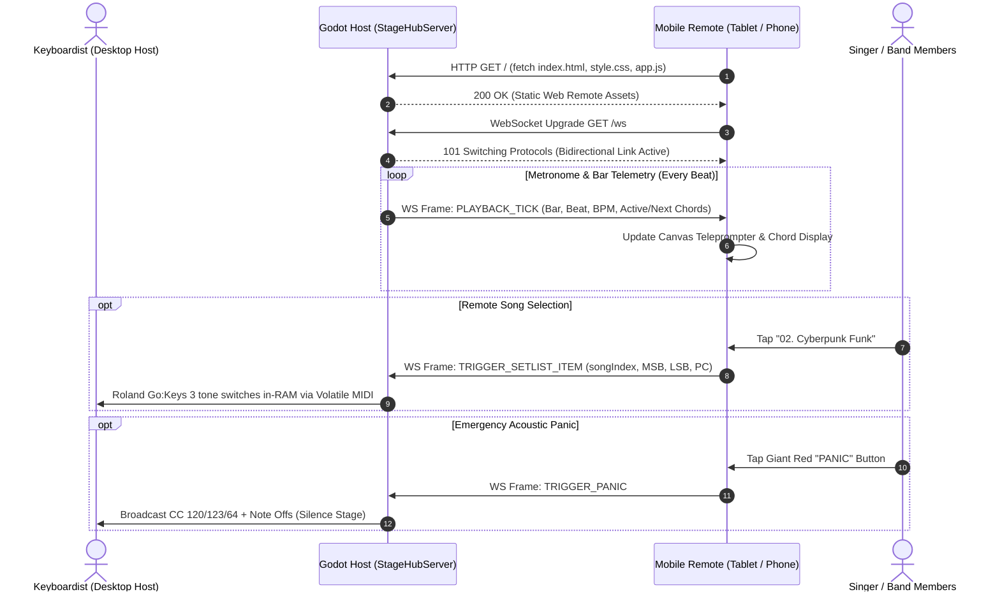

# StageHub Network Subsystem (`AnantaNada.Network`)

### Embedded Lightweight HTTP & WebSocket Server for Stand-Mounted Mobile Telemetry

> **Namespace:** `AnantaNada.Network`  
> **Host Protocol:** HTTP/1.1 Static Server + WebSocket (`RFC 6455`)  
> **Default Port:** `8080` (Configurable)  
> **Client Runtime:** Zero-install mobile browser (Android / iOS / Desktop / Tablet)

---

## 1. Network Topology & System Architecture

StageHub provides a zero-install, zero-cloud stage communications bus. The host instance running on the laptop/PC hosts the local web server and pushes live synchronization packets to musicians' stand-mounted phones or tablets over local Wi-Fi or mobile hotspot.



---

## 2. Strong-Typed JSON Data Contracts

All telemetry payloads conform to strict JSON schemas defined in `TelemetryContracts.cs`.

### 2.1. Outbound: `PLAYBACK_TICK` (Host $\to$ Remote)
Dispatched on every metronome beat or song progression step.

```json
{
  "type": "PLAYBACK_TICK",
  "data": {
    "songId": "song_042",
    "bar": 12,
    "beat": 3,
    "bpm": 128,
    "currentChord": "G#m7",
    "nextChord": "C#m7",
    "activePatch": "Vintage EP 1"
  }
}
```

#### Field Specifications:
- `songId` (`string`): Unique slug or identifier of the active composition.
- `bar` (`int`): 1-indexed measure number.
- `beat` (`int`): Current quarter-note beat ($1 \text{--} 4$ in $4/4$ time).
- `bpm` (`int`): Active tempo ($40 \text{--} 240$ BPM).
- `currentChord` (`string`): Current harmonic chord symbol (e.g. `Cmaj7`, `F#dim7`).
- `nextChord` (`string`): Upcoming anticipatory chord for teleprompter lookahead.
- `activePatch` (`string`): Human-readable name of the active Roland Go:Keys 3 sound.

### 2.2. Inbound: `TRIGGER_SETLIST_ITEM` (Remote $\to$ Host)
Triggered when a musician touches a song card on their tablet or phone.

```json
{
  "command": "TRIGGER_SETLIST_ITEM",
  "payload": {
    "songIndex": 3,
    "programChange": 14,
    "bankMsb": 87,
    "bankLsb": 64,
    "transpose": 0
  }
}
```

#### Field Specifications:
- `songIndex` (`int`): Setlist position index ($0$-based).
- `programChange` (`byte`): MIDI Program Change value ($0 \text{--} 127$).
- `bankMsb` (`byte`): Bank Select MSB (`CC 00`).
- `bankLsb` (`byte`): Bank Select LSB (`CC 32`).
- `transpose` (`int`): Coarse pitch offset in semitones ($-12 \text{ to } +12$).

### 2.3. Inbound: `TRIGGER_PANIC` (Remote $\to$ Host)
Emergency command to immediately silence stuck notes on the Roland hardware.

```json
{
  "command": "TRIGGER_PANIC"
}
```

---

## 3. High-Performance Server Implementation Details

1. **Zero External Web Frameworks**:
   - Built directly upon `System.Net.HttpListener` and `System.Net.WebSockets`.
   - Eliminates megabytes of external runtime bloat (no ASP.NET Core, no Node.js runtime).
   - Minimal memory footprint ($< 15\text{ MB}$ host memory overhead).

2. **Concurrent Client Registry & Lock-Free Thread Safety**:
   - Active client sockets are tracked in a thread-safe `ConcurrentDictionary<Guid, WebSocket>`.
   - Broadcast operations iterate through client sockets concurrently without blocking the Godot main rendering thread.
   - Sockets transitioning to `WebSocketState.Aborted` or `Closed` are automatically pruned to prevent resource leaks.

3. **MIME Type Mapping & Fallback**:
   - Serves `.html`, `.css`, `.js`, `.json`, `.png`, `.svg`, and `.mid` with proper `Content-Type` headers and UTF-8 encoding.
   - Automatically queries local network interfaces (`NetworkInterface.GetAllNetworkInterfaces()`) to detect and log the host's LAN IP address for easy mobile pairing.

---

## 4. API Reference

### 4.1. `StageHubServer`
| Member | Type | Description |
| :--- | :--- | :--- |
| `Start()` | Method | Boots the HTTP and WebSocket listener thread. |
| `Stop()` | Method | Gracefully closes all client sockets and stops listening. |
| `BroadcastPlaybackTick(PlaybackTickData data)` | Method | Broadcasts real-time chord and beat telemetry to all connected tablets. |
| `GetLocalIpAddresses()` | Method | Returns a list of active IPv4 addresses on the host machine. |
| `OnSetlistItemTriggered` | Event | Invoked when a remote client sends `TRIGGER_SETLIST_ITEM`. |
| `OnPanicTriggered` | Event | Invoked when a remote client sends `TRIGGER_PANIC`. |
| `ConnectedClientsCount` | Property | Number of currently connected WebSockets. |
| `Port` | Property | Active port number (default `8080`). |
