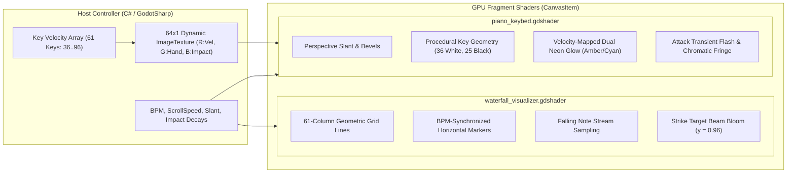

# High-Performance GPU Visualizer Shaders (`src/Shaders`)

### Diegetic Game-Grade Shaders for 61-Key Interactive Keybed & Kinetic Waterfall

> **Platform:** Godot Engine 4.x CanvasItem Shaders (`.gdshader`)  
> **Rendering Pipeline:** Forward+ / Mobile / Compatibility  
> **Target Refresh Rate:** 60 FPS to 144+ FPS without frame drops  
> **Visual Direction:** Persona 5 / Arknights / Hi-Fi Rush

---

## 1. Visual Shader Architecture

The shader suite renders visual feedback directly on the GPU, avoiding CPU rendering overhead. The C# host controller (`MainStageController.cs`) generates and streams compact texture updates to GPU uniforms per frame.

---

## 2. Mathematical Modeling & Spatial Geometry

### 2.1. 61-Key Procedural Subdivision (`piano_keybed.gdshader`)
A standard 61-key synthesizer begins at $C_2$ (MIDI 36) and ends at $C_7$ (MIDI 96).
Across 5 octaves ($5 \times 7 = 35$) plus the final high $C$, there are:
- $N_{\text{white}} = 36$ White Keys
- $N_{\text{black}} = 25$ Black Keys

The normalized screen coordinate $u \in [0, 1]$ is mapped to the white key index $W \in [0, 35]$:
$$W = \lfloor u \cdot N_{\text{white}} \rfloor$$
$$f_W = \operatorname{fract}(u \cdot N_{\text{white}})$$

Black keys are rendered on top of white keys if the vertical coordinate satisfies $v < H_{\text{black}}$ (where $H_{\text{black}} = 0.62$). Within an octave of 7 white keys ($0 = C, 1 = D, 2 = E, 3 = F, 4 = G, 5 = A, 6 = B$), a black key exists to the right of white key $k$ if:
$$k \in \{0, 1, 3, 4, 5\}$$

If $f_W < \frac{W_{\text{black}}}{2}$, the fragment belongs to the black key of the previous white key; if $f_W > 1.0 - \frac{W_{\text{black}}}{2}$, it belongs to the black key of the current white key.

### 2.2. Dual-Tone Hand Isolation & Velocity Dynamic Mapping
The keybed shader uses a hand isolation color ramp:
$$\mathbf{C}_{\text{active}} = (1 - h) \cdot \mathbf{C}_{\text{amber}} + h \cdot \mathbf{C}_{\text{cyan}}$$
Where $h \in [0, 1]$ is the channel/split flag (Left hand = $0.0$, Right hand = $1.0$).

The dynamic neon radiance is amplified exponentially with velocity:
$$I_{\text{glow}} = v_{\text{midi}}^{1.4} \cdot \Gamma_{\text{glow}}$$
Attack impact transients ($B$ channel) add an instantaneous white burst at the leading edge of a key strike, decaying smoothly according to:
$$I_{\text{transient}}(t) = I_0 \cdot e^{-\lambda t}$$

### 2.3. Kinetic Perspective Slant (Persona 5 Aesthetic)
To achieve the iconic angular stage console look, the horizontal UV coordinates are skewed according to the vertical displacement:
$$u_{\text{tilted}} = u + (v - 0.5) \cdot \theta_{\text{slant}}$$
Where $\theta_{\text{slant}} = 0.025$.

---

## 3. Shader Files & Uniform Reference

### 3.1. `piano_keybed.gdshader`
| Uniform | Type | Default | Description |
| :--- | :--- | :--- | :--- |
| `color_white_key` | `vec4` | `(0.88, 0.90, 0.94, 1.0)` | Base body color of ivory keys. |
| `color_black_key` | `vec4` | `(0.07, 0.08, 0.11, 1.0)` | Base body color of obsidian accidentals. |
| `color_neon_cyan` | `vec4` | `(0.0, 0.96, 0.83, 1.0)` | Cyber Cyan right-hand accent. |
| `color_neon_amber` | `vec4` | `(1.0, 0.72, 0.01, 1.0)` | Electric Amber left-hand accent. |
| `key_states` | `sampler2D` | Dynamic Texture | 64x1 input texture with per-key states. |
| `black_key_height_ratio` | `float` | `0.62` | Proportional length of black keys. |
| `black_key_width_ratio` | `float` | `0.58` | Proportional width of black keys. |
| `glow_intensity` | `float` | `2.2` | Multiplier for neon bloom emission. |

### 3.2. `waterfall_visualizer.gdshader`
| Uniform | Type | Default | Description |
| :--- | :--- | :--- | :--- |
| `background_color` | `vec4` | `(0.043, 0.051, 0.063, 0.95)` | Deep Obsidian canvas backing. |
| `strike_line_color` | `vec4` | `(0.0, 0.96, 0.83, 1.0)` | Cyber Cyan strike line target beam. |
| `beat_marker_color` | `vec4` | `(1.0, 0.72, 0.01, 0.35)` | Amber tempo bar grid lines. |
| `scroll_speed` | `float` | `1.2` | Visual falling note velocity. |
| `beat_frequency` | `float` | `2.0` | Spacing of metronome division lines. |
| `strike_line_y` | `float` | `0.96` | Normalized vertical hit position. |
| `bloom_spread` | `float` | `0.08` | Gaussian bloom width around strike line. |
