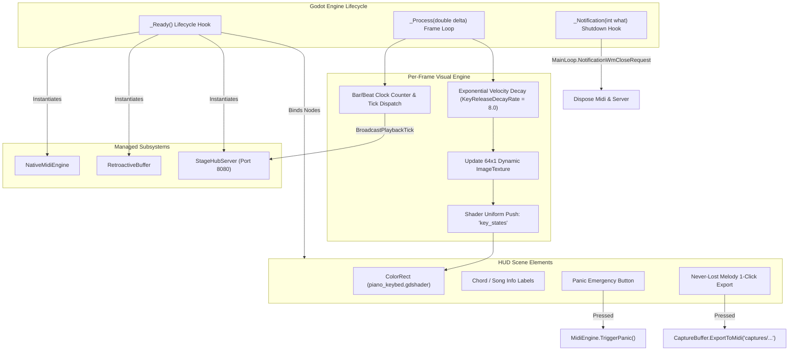

# UI Orchestration Subsystem (`AnantaNada.UI`)

### Lead Scene Controller Linking Godot 4 Canvas to Core MIDI & Network Subsystems

> **Namespace:** `AnantaNada.UI`  
> **Script:** `src/UI/MainStageController.cs`  
> **Inherits:** `Godot.Control`  
> **Primary Scene:** `res://scenes/MainStageView.tscn`

---

## 1. Controller Lifecycle & Data Flow

`MainStageController` functions as the conductor of the AnantaNada workstation. It initializes the low-level subsystems upon entering the scene tree, processes frame-by-frame visual physics (such as neon glow decay), and dispatches real-time state changes to the StageHub network server.



---

## 2. Dynamic 64-Width Keybed State Texture

Rather than creating 61 individual Godot button or node instances (which incur scene tree overhead), `MainStageController` manages a contiguous $64 \times 1$ pixel `Image` with format `Image.Format.Rgba8`:

$$\text{Pixel Buffer Layout} = 64 \times 4 = 256\text{ bytes}$$

For each key index $k \in [0, 60]$ (corresponding to MIDI note $36 + k$):
- **Red Channel ($R$)**: Key pressed velocity normalized to $[0, 255]$:
  $$R_k = \lfloor \text{velocity} \times 255 \rfloor$$
- **Green Channel ($G$)**: Hand isolation flag:
  $$G_k = \begin{cases} 0 & \text{Left hand split } (k < 24) \\ 255 & \text{Right hand split } (k \ge 24) \end{cases}$$
- **Blue Channel ($B$)**: Attack impact transient flash $[0, 255]$.
- **Alpha Channel ($A$)**: Constant $255$ ($1.0$).

During `_Process(double delta)`:
$$\text{velocity}_k \leftarrow \max(0, \text{velocity}_k - \text{KeyReleaseDecayRate} \times \delta)$$
$$\text{impact}_k \leftarrow \max(0, \text{impact}_k - 14.0 \times \delta)$$

This approach guarantees zero heap allocations in the render loop while achieving silky smooth 120 FPS+ neon fade-outs.

---

## 3. Remote Telemetry Synchronization

When a connected mobile client triggers a setlist change (`OnSetlistItemTriggered`), the controller:
1. Marshals execution to the Godot main thread using `CallDeferred`.
2. Updates on-screen chord charts, BPM, and song title.
3. Automatically triggers volatile patch switching on the Roland Go:Keys 3:
   ```csharp
   MidiEngine.SelectPatchVolatile(0, song.BankMsb, song.BankLsb, song.Pc);
   ```
4. Broadcasts an updated `PLAYBACK_TICK` to all connected mobile remotes to keep lead sheets in lockstep.

---

## 4. Export & Failsafe Handling

- **Never-Lost Melody 1-Click Export (`OnExportScratchpadPressed`)**:
  Generates an automatic timestamped file path:
  $$\text{captures/jam\_YYYYMMDD\_HHmmss.mid}$$
  Serializes the last 5 minutes of jamming directly into valid SMF Format 0, automatically creating the `captures/` folder if needed.
- **Panic Trigger (`OnPanicPressed`)**:
  Instantly dispatches CC 120, CC 123, CC 64 across all 16 MIDI channels, resets driver handles, and clears on-screen visual key glows.
