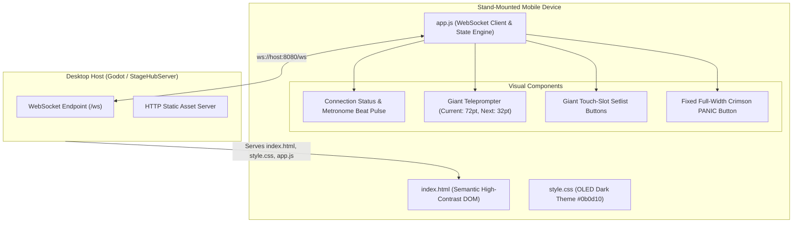

# Mobile Stage Remote Client (`web/`)

### Zero-Install HTML5 / Canvas2D Stand-Mounted Teleprompter & Setlist Controller

> **Serving Layer:** Embedded `StageHubServer` (`http://<HOST_IP>:8080/`)  
> **Client Runtime:** Evergreen Mobile Browser (Chrome Android, Safari iOS, iPadOS, Tablets)  
> **Telemetry Transport:** Raw WebSocket (`ws://<HOST_IP>:8080/ws`)  
> **Thermal Profile:** Zero thermal throttling, lightweight DOM & Canvas rendering, 0 external npm dependencies

---

## 1. Overview & Architecture

The `web/` application provides a lightweight, zero-latency companion HUD for musicians, vocalists, and keyboardists who mount a tablet or smartphone onto their microphone or keyboard stand.



---

## 2. Key Stage-Optimized Features

1. **Zero-Install Experience**:
   - Bandmates do not need to download or install an app from the App Store or Google Play.
   - Simply connect the phone/tablet to the keyboardist's Wi-Fi hotspot, open any browser, and navigate to the displayed host URL.

2. **Ultra-High Contrast OLED Aesthetic**:
   - Deep pure obsidian background (`#0b0d10`) prevents glare on dark stages while drastically reducing battery consumption on OLED displays.
   - 72pt primary chord display readable from over 2 meters away.

3. **Touch-Safe Large Target Zones**:
   - Buttons are sized with generous touch padding ($> 64\text{ px}$ target height), enabling musicians to switch songs reliably with a quick tap without looking away from the crowd.

4. **Self-Healing WebSocket Connection**:
   - If Wi-Fi signal wavers during a festival or venue performance, `app.js` runs an auto-reconnect backoff loop every 2.5 seconds until connection is restored:
   ```javascript
   if (!reconnectInterval) {
     reconnectInterval = setInterval(connectWebSocket, 2500);
   }
   ```

5. **Persistent Instant Panic Failsafe**:
   - The crimson Panic button is permanently docked at the bottom of the viewport with a high `z-index`.
   - Tapping it sends immediate `{"command":"TRIGGER_PANIC"}` over the WebSocket, instructing the host to silence all hung notes across all 16 MIDI channels.

---

## 3. Directory Structure

```text
web/
├── index.html     # Semantic mobile layout, viewport meta, HUD containers
├── style.css      # OLED theme, neon glow animations, responsive flex layout
└── app.js         # WebSocket lifecycle, payload dispatch, DOM reactive update
```
